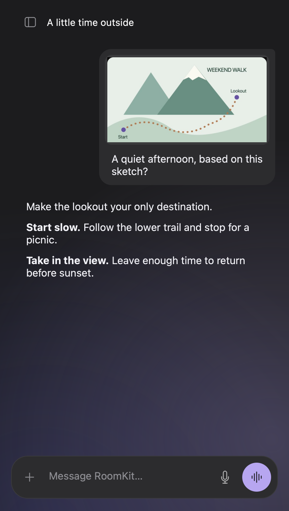
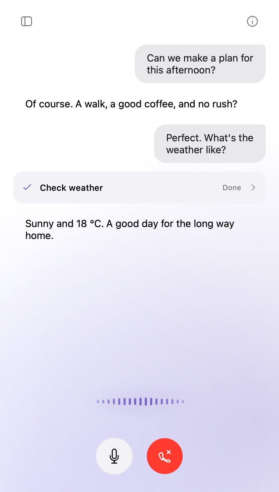
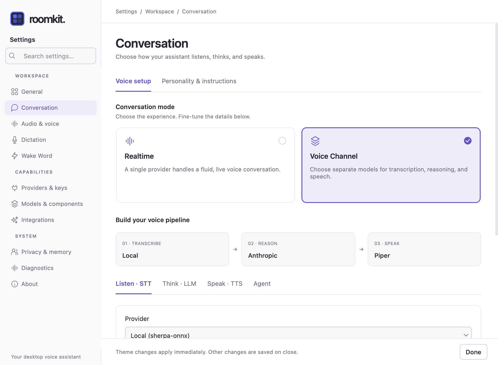

# RoomKit UI

<p align="center">
  
</p>

A native desktop assistant for **text, images and Live voice**, built with [PySide6](https://doc.qt.io/qtforpython-6/) and [RoomKit](https://github.com/roomkit-live/roomkit). Keep separate conversations, bring your own tools, and choose cloud or local models.


<p align="center">
  
  
</p>

[Explore the interface](https://www.roomkit.live/roomkit-ui/) ·
[Feature guide](docs/features.md) · [Changelog](CHANGELOG.md)

This README and the screenshots describe the current `main` branch. Features under
**Unreleased** in the changelog are coming in the next release; use a source checkout
to try them today.

## Install with uv (recommended)

For now, the recommended install is [uv](https://docs.astral.sh/uv/)'s tool installer:
RoomKit UI gets an environment of its own and a `roomkit-ui` command on your PATH, on
macOS, Linux and Windows alike.

```bash
uv tool install --python 3.12 "roomkit-ui[all]"
roomkit-ui
```

- `[all]` brings every AI backend. Without it you get the core alone (the window, the
  microphone pipeline, MCP and CLI tools), and add the backends you use, for example
  `"roomkit-ui[anthropic,meta-stt,elevenlabs]"`; `roomkit-ui --doctor` lists what this
  install carries.
- Five extras stay out of `all`: `qwen3-tts`, `neutts` and `smart-turn` pin conflicting
  `transformers` versions, so take at most one of them (`"roomkit-ui[all,smart-turn]"`),
  and `pocket-tts` and `vui` pull in torch. `vui` installs on Python 3.12 only:
  `uv tool install --python 3.12 "roomkit-ui[all,vui]"`.
- Upgrade from the app (it tells you when a release is out; Settings → About) or with
  `uv tool upgrade roomkit-ui`; remove with `uv tool uninstall roomkit-ui`. A backend the
  app installs (Settings → Models & components → Components) is recorded in the tool's
  receipt, so upgrades keep it. One installed by an earlier version is recorded on the
  next component install or update from the app.
- To try the `main` branch before it is released:
  `uv tool install --python 3.12 "roomkit-ui[all] @ git+https://github.com/roomkit-live/roomkit-ui"`.
- On macOS, the microphone permission goes to the terminal you start `roomkit-ui` from.

Each release tag publishes the package to [PyPI](https://pypi.org/project/roomkit-ui/).

## Download

Pre-built binaries are available for macOS, Linux, and Windows on the [Releases](https://github.com/roomkit-live/roomkit-ui/releases) page.

### macOS

```bash
brew install --cask roomkit-live/tap/roomkit-ui
```

Apple Silicon, macOS 13 (Ventura) or later. Grant microphone permission when
prompted on first launch.

The cask is only published for a release whose app is notarized: the build
workflow checks the DMG with `xcrun stapler validate` and leaves the tap
untouched otherwise. A release built without the Apple signing credentials
ships its DMG on the Releases page only.

Downloading the DMG by hand works too. If that build was produced without
signing credentials, macOS blocks it as unnotarized — clear the quarantine
attribute before opening it:

```bash
xattr -cr "RoomKit UI.app"
```

## Features

- **Text and images** — streaming replies, an input that grows to eight lines, image files, camera capture, clipboard paste and drag-and-drop; review attachments before sending
- **Dictate a message** — speak into the input, edit the transcript, then send when ready
- **Two conversation modes** — Speech-to-Speech (realtime) or Voice Channel (STT → LLM → TTS)
- **Realtime providers** — Gemini Live (Gemini 3.8 Live options follow the selected model), OpenAI Realtime, OpenAI GPT-Live (full-duplex), Deepgram Voice Agent, ElevenLabs Conversational AI, xAI Grok
- **Voice Channel providers** — LLM: Anthropic (Claude Sonnet 5.5 by default), OpenAI, Gemini, local vLLM / Ollama, or llama.cpp; STT: local sherpa-onnx, Deepgram, Gradium, Azure MAI-Transcribe, Meta Muse Voice Transcribe; TTS: Piper, Kokoro, Pocket TTS, Vui, Qwen3-TTS, NeuTTS, ElevenLabs, Gradium, Azure MAI-Voice. Model lists come from roomkit's catalogs
- **Local LLM with nothing to install** — llama.cpp: roomkit downloads a pinned `llama-server` and the GGUF model at first use
- **Local TTS** — offline text-to-speech with Piper, Kokoro (37 voices in five languages), Pocket TTS (seven languages, voice clone), Vui (English, NVIDIA GPU, replies inside the conversation, voice clone), Qwen3-TTS (voice clone), and NeuTTS (voice clone)
- **Who is speaking** — with Meta Muse as the STT, the voices are told apart live, no enrolment: click a speaker in the chat to name them, the assistant names those who introduce themselves, and "Listen only to primary speaker" follows your name. With local STT, enrolled voices are recognised offline
- **Wake word** — say an enrolled phrase to open a session; detection runs locally and nothing leaves the machine until it fires. Optional hang-up once the conversation goes quiet
- **Conversation history** — separate threads with automatic titles, 30 recent conversations, title search, rename and delete; reopen a thread with its own context, images and saved tool results
- **Real-time voice** — full-duplex voice conversation with interruption support; in Voice Channel mode, barge-in can be off, on any speech, or on words only (an "ok" or "mm-hmm" lets the assistant go on)
- **Clean speech** — the Voice Channel voice skips emoji, tool JSON and stage directions
- **Animated VU meter** — ambient glow visualization for mic and speaker audio levels
- **Chat transcript** — the assistant's text rolls out with its voice, markdown rendered; streaming transcriptions
- **Session usage** — token counts in the session panel, with a cost estimate in Voice Channel mode
- **System-wide dictation** — global hotkey triggers STT and pastes text into the focused app (macOS, Linux, Windows)
- **Local STT models** — offline dictation with downloadable sherpa-onnx models (Whisper, Parakeet, Zipformer)
- **MCP tool support** — stdio, SSE and streamable HTTP, with Bearer, raw API key, Basic or OAuth 2.0 authentication
- **MCP Apps** — interactive tool UIs inline in the chat; saved results reopen with the conversation without running tools again
- **CLI tools** — declare a local command-line binary and the assistant can run it
- **Echo cancellation** — WebRTC or Speex AEC for hands-free use
- **Noise suppression** — RNNoise, GTCRN or DPDFNet denoiser for noisy environments
- **GPU inference** — optional CUDA (NVIDIA) or CoreML (Apple) acceleration for local STT models
- **Audio device selection** — pick your microphone and speaker from settings
- **Dark & Light themes** — Apple-inspired UI with theme switcher
- **System tray** — tray icon with dictation status, quick toggle, and notifications
- **Multi-language STT** — 14+ languages for dictation (auto-detect, English, French, Spanish, etc.)
- **Whisper translation** — translate speech to English using Whisper models

## Requirements

- Python 3.12+
- [uv](https://docs.astral.sh/uv/) (recommended) or pip
- An API key for your chosen provider — none for an all-local Voice Channel (local STT, a local LLM, Piper, Kokoro or Pocket TTS)
- PortAudio (`libportaudio2` on Linux, included on macOS)
- **Linux dictation deps** — `xclip` + `xdotool` (X11) or `wl-copy` + `wtype` (Wayland) for the system-wide STT dictation feature. macOS and Windows need no extra program: Windows pastes through the Win32 API

## Run from source

```bash
git clone https://github.com/roomkit-live/roomkit-ui.git
cd roomkit-ui
uv sync --extra all
uv run python -m roomkit_ui
```

A bare `uv sync` installs the core only — the window, the microphone pipeline
with WebRTC echo cancellation, MCP and CLI tools. Every AI backend arrives
through an extra, so you install what you use.

On macOS, **+ → Take a photo** opens an isolated camera window with the app bundle
declaration required by the system. The main application keeps its original Python
executable and Keychain access; the camera helper never loads API keys. A reviewed
photo returns directly to your draft, without a temporary photo file. Camera access
is requested on opening the camera, not at startup. If you previously refused it,
the dialog links to **System Settings → Privacy & Security → Camera**.

## Optional features

| Extra | What it adds |
| --- | --- |
| `anthropic` | Claude, as the Voice Channel LLM |
| `openai` | OpenAI Realtime, OpenAI GPT-Live, xAI Grok, the OpenAI LLM, and local vLLM / Ollama |
| `gemini` | Gemini Live and the Gemini LLM |
| `deepgram` | Deepgram Voice Agent, transcription and dictation |
| `elevenlabs` | ElevenLabs Conversational AI and TTS |
| `gradium` | Gradium STT and TTS |
| `azure-speech` | Microsoft Foundry speech: Azure MAI-Transcribe (STT) and Azure Speech TTS with MAI-Voice |
| `meta-stt` | Meta's Muse Voice Transcribe (STT) |
| `typesafe` | TypeSafe's Jev, one of the classifiers that decide when the Voice Channel assistant speaks |
| `local-voice` | Offline speech: sherpa-onnx STT, Piper TTS, VAD, speaker diarization |
| `llamacpp` | llama.cpp, a local GGUF model; roomkit fetches `llama-server` and the model at first use |
| `dictation` | Global-hotkey dictation (implies `local-voice`) |
| `wakeword` | Wake word detection (implies `local-voice`; onnxruntime runs the whisper encoder it matches with) |
| `mcp-apps` | Embedded MCP App web UIs, notification sounds, audio preview |
| `camera` | Camera capture and review for image attachments |
| `telemetry` | OpenTelemetry / OTLP trace export |
| `qwen3-tts`, `neutts` | Voice cloning — see the note below |
| `pocket-tts` | Kyutai's Pocket TTS: local, CPU-friendly, seven languages, voice cloning from a clip |
| `vui` | Vui Nano (fluxions.ai): local, English, an NVIDIA GPU, Python 3.12 only; replies generated inside the conversation, your voice included |
| `smart-turn` | Smart Turn detector for the Voice Channel (end-of-turn from the audio) |
| `cloud` | All eight cloud backends at once (`anthropic` to `typesafe`) |
| `all` | Everything above except `qwen3-tts`, `neutts`, `pocket-tts`, `vui` and `smart-turn` |

```bash
pip install 'roomkit-ui[gemini,local-voice]'   # pick what you need
pip install 'roomkit-ui[all]'                  # or take the lot
```

A plain `pip install roomkit-ui` installs the core only, with no AI backend.

`qwen3-tts`, `neutts` and `smart-turn` **cannot be installed together** — they pin
conflicting `transformers` versions (qwen-tts `4.57.3`, neutts `5.1.0`, Smart Turn
`>=5.5`): pick at most one. `qwen3-tts`, `neutts`, `pocket-tts` and `vui` also pull
torch, several GB (Pocket TTS and Vui take the CUDA build on Linux). None of the five is
in `all`, so the pre-built binaries carry none of them. `vui` installs on Python 3.12
only (vui-tts refuses 3.13): on another Python, `--doctor` and Settings say so.

To see what the current install carries and what completes it:

```bash
roomkit-ui --doctor
```

The app never fails silently on a missing backend: unavailable providers are
marked in Settings, and starting a session with one says so in the chat. In a pip,
pipx or uv tool install, **Settings → Models & components → Components** installs them (as does the
Install button next to a provider marked "not installed", or in the chat); in a
source checkout it gives the `uv sync --inexact --extra …` command to run.

### GPU acceleration (optional)

Local STT models can run on GPU for faster inference. The inference device can be selected in Settings > Audio & voice > Devices & processing.

**NVIDIA CUDA** (Linux):

Requires cuDNN 9 and the sherpa-onnx CUDA wheel:

```bash
# Install cuDNN 9
sudo apt-get install cudnn9-cuda-12

# Install the CUDA wheel of the locked sherpa-onnx version (after uv sync)
uv pip install "sherpa-onnx==1.13.4+cuda12.cudnn9" \
    -f https://k2-fsa.github.io/sherpa/onnx/cuda.html
```

Match the version to what `uv pip show sherpa-onnx` reports (1.13.4 in the current
lock). Since 1.13 the CPU build keeps its native libraries in a separate
`sherpa-onnx-core` package, at the same paths the self-contained CUDA wheel
writes, so a CUDA wheel of another version mixes two builds' libraries.

> **Note:** `uv sync` and `uv run` will reinstall the CPU wheel from PyPI. Use `uv run --no-sync` to preserve the CUDA wheel, or reinstall after syncing.

**CoreML** (macOS): Available automatically with the standard sherpa-onnx package.

## Usage

1. Open **Conversations** with the top-left icon, then click **Settings** at the bottom
2. Add your provider's API key in **Providers & keys**, or configure a local model.
   For text and images, select your LLM under **Conversation → Voice Channel → Think · LLM**;
   for Live, choose **Realtime** or your **Voice Channel** pipeline
3. Close **Settings** to save, Esc included; the light/dark theme applies immediately
4. Type a message and press **Enter** or the send arrow. **Shift+Enter** adds a line;
   the input grows to eight visual lines, then scrolls. Use **+** to choose images or
   take a photo, paste a copied image, or drop image files into the input. Review up to
   four attachments and send with or without text. Image understanding needs a model
   that supports vision
5. With an empty draft, press the **Live waveform icon** to start talking. The red
   hang-up icon ends Live while keeping the conversation on screen

The compact home has one input row: **+** for images and camera photos, text, a dictation
microphone, and the Live icon. Configure a chat model to send text and images. Click the
small microphone to dictate with the provider and language in **Settings → Dictation**;
click it again to finish. The transcription is inserted at the cursor for review before
sending. The cross cancels dictation and keeps the existing draft and images. This works
independently of the global dictation shortcut and needs no clipboard or Accessibility
access. Missing speech configuration is explained in the microphone tooltip.

During Live, the microphone and hang-up controls stay below the transcript.
The violet waveform follows voice activity; muting the microphone keeps playback
audible. The **information icon** opens a sliding panel with active models by role and voice,
personality, tools, skills and reported usage. Search tools and skills by name or
description, then expand an entry to read it. Usage updates while the panel is open;
the conversation continues. Close it with Escape, the cross or **Back to conversation**.
Settings is available in the conversation panel once the session ends.
Home, startup and conversation share the same background. Startup progress appears
in the conversation area with Cancel below it; speaking decisions stay in the logs.

The **top-left history icon** opens a sliding panel with **Recent** (the 30 most recently
active conversations), search across all conversation titles, and **New conversation**.
Titles start with your first message, then the configured text model summarizes the
subject when available. Use **⋯ → Rename** or **F2** to choose your own title.
**⋯ → Delete…** removes a conversation and its locally saved content after confirmation.
Hanging up keeps the transcript on screen. Open a saved
conversation to read it, then press Live to continue that thread; the microphone stays
off while browsing. End Live before switching conversations. Earlier shared history
appears as **Earlier history**. With **Remember conversations** off, new exchanges
remain available only until the application closes.

Search Settings with **Ctrl/Cmd+K** or **Ctrl/Cmd+F**. Results open the matching
page and focus its control; Escape clears the search.

**Conversation** uses two large cards to choose **Realtime** or **Voice Channel**.
The Voice Channel overview shows the selected transcription, reasoning and speech
providers, with detailed controls below. Arrow keys switch between the mode cards;
pending settings remain intact when switching modes or themes.

**Models & components** groups downloadable model files and optional components in two
tabs. Filter models by use or download status, and components by installation status.
Downloads continue when you close Settings; reopening shows their current progress.
Use downloaded files in Conversation, Dictation, Audio & voice or Wake Word.

**Integrations** groups **MCP servers**, **CLI tools** and **Skills**. Search each list
by name, use **Manage** on an entry to edit it, or add a new one. Skills shows installed
skills with a **Browse skills.sh** button at the top and a **Manage sources** link for
folders/repositories. MCP and CLI editors keep
environment variables and other advanced options in a disclosure below the main fields.
An MCP server's page also says whether its skills and the instructions it publishes on
using its tools reach the assistant (both on by default).

For an SSE or streamable HTTP server, select **Authentication** explicitly:

| Method | What to enter |
| --- | --- |
| None | No Authorization header |
| API token (Bearer) | Your token; the Bearer prefix is added automatically |
| API key (raw Authorization) | The exact value the server expects in Authorization |
| Username & password (Basic) | Separate username and password fields |
| OAuth 2.0 | Connect through the browser; optional client details under Advanced options |

Tokens and passwords are masked. Additional headers, such as `X-Workspace`, belong
under **Advanced options**; every header value uses the existing secret store.
Older `Authorization` headers are recognized and moved into the matching form fields.
Choosing None removes manual Authorization; OAuth manages its own authorization.

**Diagnostics** groups **Recorded audio**, **Pipeline capture** and **Telemetry**.
Filter WAV files by name or source, play them, or open either output folder. Deletion
asks you to confirm the displayed files; files outside the selection remain untouched.
Capture and trace-export changes apply to the next session. **About** includes the
installed version, a copy-version-info action and the full MIT license.

### Local STT dictation

1. Go to **Settings > Models & components > Local models** and download a speech-to-text model
2. Go to **Settings > Dictation**, enable dictation, choose your shortcut, and set
   **Speech recognition provider** to **Local**, then select your model
3. Press the global hotkey to record, then press it again to finish and paste

Streaming models, including Kroko, transcribe during recording. The local model loads
before recording starts and stays warm for the next dictation; batch models transcribe
after capture stops. The input microphone uses the same settings but inserts the result
into your draft instead of another app. On macOS, if automatic paste is blocked, the
transcript remains on the clipboard for manual ⌘V; check Accessibility and Automation
permissions for the app or terminal that launched it.

### Wake word

1. Go to **Settings > Wake Word**. Open **Components & local models** to install any
   missing component and download the encoder (~12 MB) and TEN VAD. Downloads continue
   if you close Settings; their progress is shared with **Models & components**
2. Click **Record a phrase…** and follow the guided recording: the phrase said
   normally, more quietly and from further away, then a few words that sound
   close to it and must not wake it
3. Enable **Listen for the wake word**. Saying the phrase opens a session, and what
   you say right after it reaches the assistant. **Automatic hangup** returns to
   listening after the configured quiet period

The wake word stands down during a session, during dictation and while Settings
is open.
Recording or forgetting a phrase takes effect immediately; other settings save on close.

## Documentation

- [Onboarding](docs/onboarding.md) — dev setup in under 30 minutes
- [Architecture](docs/architecture.md) — components, data flow, security model
- [Features](docs/features.md) — what the app does, workflows, limitations
- [Technical reference](docs/technical.md) — stack, patterns, testing, tech debt

## Project Structure

```
src/roomkit_ui/
├── app.py, features.py         # Startup; optional-backend registry behind --doctor
├── engine*.py                  # Voice session: lifecycle, Voice Channel and realtime modes,
│                               #  audio pipeline, provider callbacks, tool dispatch
├── realtime_providers.py       # Realtime provider builders and per-provider audio wiring
├── hooks.py, watchdog.py, idle_hangup.py, cleanup.py   # UI events, stall nudge, auto-hangup, loop cleanup
├── builtin_tools.py, toolset.py, memory.py             # Built-in tools, tool grouping, conversation memory
├── mcp_*.py, url_policy.py     # MCP client, HTTP authentication, MCP Apps bridge and URL policy
├── cli_*.py, env_config.py     # CLI tools
├── skill_*.py, skills_sh_client.py                      # Agent Skills sources and skills.sh
├── stt_*.py, dictation_stream.py, hotkey.py, paste*.py, tray.py  # Composer and global dictation
├── model_*.py, download_flight.py                       # Local model catalog and downloads
├── speaker_manager.py, enrollment.py                    # Speaker profiles for diarization
├── speaker_roster.py, speaker_naming.py                 # Voices Meta Muse tells apart, and their names
├── settings*.py, secret_store.py                        # QSettings + keyring
├── theme.py, icons.py, sounds.py, constants.py, aec_dump.py
├── providers/, tts/            # LLM and TTS factories (lazy registries)
├── wakeword/                   # Wake word: capture, detection, enrolment
└── widgets/                    # Main window, chat, MCP App views, wake-word wizard,
                                #  settings workspace with grouped navigation
```

Every module is described in the Architecture section of [CLAUDE.md](CLAUDE.md).

### Interface screenshots

<picture>
  <source media="(prefers-color-scheme: dark)" srcset="assets/screenshots/settings-dark.png">
  
</picture>

The [screenshot gallery](assets/screenshots/README.md) contains real widgets with demo
content in both themes. Regenerate it without connecting providers or opening devices:

```bash
.venv/bin/python scripts/capture_screenshots.py
```

## Building

```bash
./scripts/build_app.sh
```

The script is the reference build. It installs `--extra all` and carries the
PyInstaller flags a working bundle needs: `--collect-submodules=roomkit,roomkit_ui`
(the backends load through string-keyed registries PyInstaller cannot follow), the
hidden imports and the native libraries. The release workflow
(`.github/workflows/build.yml`) passes the same flags, and
`tests/test_build_flags.py` fails when they differ — a bare `pyinstaller` call
produces an app without its backends. The app icon is used when present: generate
it first with `python scripts/generate_icons.py` (needs Pillow and cairosvg; use
`--force` after changing the logo). The generator also syncs the packaged icons;
macOS uses a padded version for both the Dock and the app bundle. On
macOS, the script signs and notarizes when the environment variables listed at
its top are set.

## Contributing

See [CONTRIBUTING.md](CONTRIBUTING.md). Run the quality checks before opening a PR:

```bash
uv run ruff check . && uv run ruff format --check . && uv run mypy src/ && uv run pytest
```

## License

MIT License — Copyright (c) 2026 Sylvain Boily
