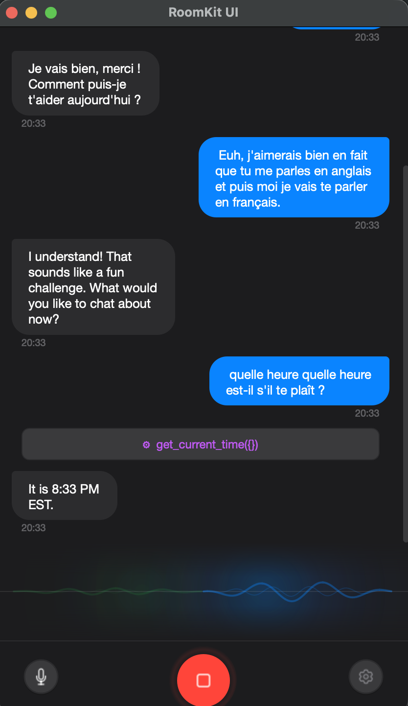

# RoomKit UI

<p align="center">
  
</p>

A desktop voice assistant built with [PySide6](https://doc.qt.io/qtforpython-6/) and [RoomKit](https://github.com/roomkit-live/roomkit). Supports real-time voice conversations with **Google Gemini**, **OpenAI**, **Anthropic**, **Deepgram**, **ElevenLabs**, **xAI Grok**, and **local LLMs**.


<p align="center">
  
</p>

## Download

Pre-built binaries are available for macOS, Linux, and Windows on the [Releases](https://github.com/roomkit-live/roomkit-ui/releases) page.

### macOS

```bash
brew install --cask roomkit-live/tap/roomkit-ui
```

Apple Silicon, macOS 13 (Ventura) or later. Grant microphone permission when
prompted on first launch.

The cask is only published for a release whose app is notarized: the build
workflow checks the DMG with `xcrun stapler validate` and leaves the tap
untouched otherwise. A release built without the Apple signing credentials
ships its DMG on the Releases page only.

Downloading the DMG by hand works too. If that build was produced without
signing credentials, macOS blocks it as unnotarized — clear the quarantine
attribute before opening it:

```bash
xattr -cr "RoomKit UI.app"
```

## Features

- **Two conversation modes** — Speech-to-Speech (realtime) or Voice Channel (STT → LLM → TTS)
- **Realtime providers** — Gemini Live (Gemini 3.8 Live options follow the selected model), OpenAI Realtime, OpenAI GPT-Live (full-duplex), Deepgram Voice Agent, ElevenLabs Conversational AI, xAI Grok
- **Voice Channel providers** — LLM: Anthropic (Claude Sonnet 5.5 by default), OpenAI, Gemini, local vLLM / Ollama, or llama.cpp; STT: local sherpa-onnx, Deepgram, Gradium, Azure MAI-Transcribe; TTS: Piper, Pocket TTS, Qwen3-TTS, NeuTTS, ElevenLabs, Gradium, Azure MAI-Voice. Model lists come from roomkit's catalogs
- **Local LLM with nothing to install** — llama.cpp: roomkit downloads a pinned `llama-server` and the GGUF model at first use
- **Local TTS** — offline text-to-speech with Piper, Pocket TTS (seven languages, voice clone), Qwen3-TTS (voice clone), and NeuTTS (voice clone)
- **Wake word** — say an enrolled phrase to open a session; detection runs locally and nothing leaves the machine until it fires. Optional hang-up once the conversation goes quiet
- **Conversation memory** — sessions share a persistent history; the assistant can search past conversations
- **Real-time voice** — full-duplex voice conversation with interruption support; in Voice Channel mode, barge-in can be off, on any speech, or on words only (an "ok" or "mm-hmm" lets the assistant go on)
- **Clean speech** — the Voice Channel voice skips emoji, tool JSON and stage directions
- **Animated VU meter** — ambient glow visualization for mic and speaker audio levels
- **Chat transcript** — the assistant's text rolls out with its voice, markdown rendered; streaming transcriptions
- **Session usage** — token counts in the info bar, with a cost estimate in Voice Channel mode
- **System-wide dictation** — global hotkey triggers STT and pastes text into the focused app (macOS, Linux, Windows)
- **Local STT models** — offline dictation with downloadable sherpa-onnx models (Whisper, Parakeet, Zipformer)
- **MCP tool support** — connect external tools via Model Context Protocol (stdio, SSE, HTTP) with OAuth2 authentication
- **MCP Apps** — render HTML UIs served by MCP servers inline in the chat
- **CLI tools** — declare a local command-line binary and the assistant can run it
- **Echo cancellation** — WebRTC or Speex AEC for hands-free use
- **Noise suppression** — RNNoise or GTCRN denoiser for noisy environments
- **GPU inference** — optional CUDA (NVIDIA) or CoreML (Apple) acceleration for local STT models
- **Audio device selection** — pick your microphone and speaker from settings
- **Dark & Light themes** — Apple-inspired UI with theme switcher
- **System tray** — tray icon with dictation status, quick toggle, and notifications
- **Multi-language STT** — 14+ languages for dictation (auto-detect, English, French, Spanish, etc.)
- **Whisper translation** — translate speech to English using Whisper models

## Requirements

- Python 3.12+
- [uv](https://docs.astral.sh/uv/) (recommended) or pip
- An API key for your chosen provider — none for an all-local Voice Channel (local STT, a local LLM, Piper or Pocket TTS)
- PortAudio (`libportaudio2` on Linux, included on macOS)
- **Linux dictation deps** — `xclip` + `xdotool` (X11) or `wl-copy` + `wtype` (Wayland) for the system-wide STT dictation feature. macOS and Windows need no extra program: Windows pastes through the Win32 API

## Run from source

```bash
git clone https://github.com/roomkit-live/roomkit-ui.git
cd roomkit-ui
uv sync --extra all
uv run python -m roomkit_ui
```

A bare `uv sync` installs the core only — the window, the microphone pipeline
with WebRTC echo cancellation, MCP and CLI tools. Every AI backend arrives
through an extra, so you install what you use.

## Optional features

| Extra | What it adds |
| --- | --- |
| `anthropic` | Claude, as the Voice Channel LLM |
| `openai` | OpenAI Realtime, OpenAI GPT-Live, xAI Grok, the OpenAI LLM, and local vLLM / Ollama |
| `gemini` | Gemini Live and the Gemini LLM |
| `deepgram` | Deepgram Voice Agent, transcription and dictation |
| `elevenlabs` | ElevenLabs Conversational AI and TTS |
| `gradium` | Gradium STT and TTS |
| `azure-speech` | Microsoft Foundry speech: Azure MAI-Transcribe (STT) and Azure Speech TTS with MAI-Voice |
| `typesafe` | TypeSafe's Jev, one of the classifiers that decide when the Voice Channel assistant speaks |
| `local-voice` | Offline speech: sherpa-onnx STT, Piper TTS, VAD, speaker diarization |
| `llamacpp` | llama.cpp, a local GGUF model; roomkit fetches `llama-server` and the model at first use |
| `dictation` | Global-hotkey dictation (implies `local-voice`) |
| `wakeword` | Wake word detection (implies `local-voice`; onnxruntime runs the whisper encoder it matches with) |
| `mcp-apps` | Embedded MCP App web UIs, notification sounds, audio preview |
| `telemetry` | OpenTelemetry / OTLP trace export |
| `qwen3-tts`, `neutts` | Voice cloning — see the note below |
| `pocket-tts` | Kyutai's Pocket TTS: local, CPU-friendly, seven languages, voice cloning from a clip |
| `smart-turn` | Smart Turn detector for the Voice Channel (end-of-turn from the audio) |
| `cloud` | All eight cloud backends at once (`anthropic` to `typesafe`) |
| `all` | Everything above except `qwen3-tts`, `neutts`, `pocket-tts` and `smart-turn` |

```bash
pip install 'roomkit-ui[gemini,local-voice]'   # pick what you need
pip install 'roomkit-ui[all]'                  # or take the lot
```

A plain `pip install roomkit-ui` installs the core only, with no AI backend.

`qwen3-tts`, `neutts` and `smart-turn` **cannot be installed together** — they pin
conflicting `transformers` versions (qwen-tts `4.57.3`, neutts `5.1.0`, Smart Turn
`>=5.5`): pick at most one. `qwen3-tts`, `neutts` and `pocket-tts` also pull torch,
several GB (Pocket TTS takes the CUDA build on Linux). None of the four is in `all`,
so the pre-built binaries carry none of them.

To see what the current install carries and what completes it:

```bash
roomkit-ui --doctor
```

The app never fails silently on a missing backend: unavailable providers are
marked in Settings, and starting a session with one names the install command
in the chat.

### GPU acceleration (optional)

Local STT models can run on GPU for faster inference. The inference device can be selected in Settings > General > Audio Processing.

**NVIDIA CUDA** (Linux):

Requires cuDNN 9 and the sherpa-onnx CUDA wheel:

```bash
# Install cuDNN 9
sudo apt-get install cudnn9-cuda-12

# Install the CUDA wheel of the locked sherpa-onnx version (after uv sync)
uv pip install "sherpa-onnx==1.13.4+cuda12.cudnn9" \
    -f https://k2-fsa.github.io/sherpa/onnx/cuda.html
```

Match the version to what `uv pip show sherpa-onnx` reports (1.13.4 in the current
lock). Since 1.13 the CPU build keeps its native libraries in a separate
`sherpa-onnx-core` package, at the same paths the self-contained CUDA wheel
writes, so a CUDA wheel of another version mixes two builds' libraries.

> **Note:** `uv sync` and `uv run` will reinstall the CPU wheel from PyPI. Use `uv run --no-sync` to preserve the CUDA wheel, or reinstall after syncing.

**CoreML** (macOS): Available automatically with the standard sherpa-onnx package.

## Usage

1. Click the gear icon to open **Settings**
2. Go to **AI Provider**, select your provider and enter your API key
3. Close **Settings** — there is no Save button: changes are saved however the
   dialog is closed, Esc included — then press the green call button to start a
   voice session
4. Speak naturally — the AI will respond in real-time
5. Press the red button to end the session

### Local STT dictation

1. Go to **Settings > AI Models** and download a speech-to-text model
2. Go to **Settings > Dictation**, set STT Provider to **Local** and select your model
3. Press the global hotkey to record, release to transcribe and paste

### Wake word

1. Go to **Settings > Wake Word**. If the encoder is missing, click
   **Download encoder (~12 MB)**
2. Click **Set up wake word…** and follow the guided recording: the phrase said
   normally, more quietly and from further away, then a few words that sound
   close to it and must not wake it
3. Check **Listen for the wake word**. Saying the phrase opens a session, and what
   you say right after it reaches the assistant. **Hang up when the conversation
   goes quiet** returns to listening on its own

The wake word stands down during a session, during dictation and while Settings
is open.

## Documentation

- [Onboarding](docs/onboarding.md) — dev setup in under 30 minutes
- [Architecture](docs/architecture.md) — components, data flow, security model
- [Features](docs/features.md) — what the app does, workflows, limitations
- [Technical reference](docs/technical.md) — stack, patterns, testing, tech debt

## Project Structure

```
src/roomkit_ui/
├── app.py, features.py         # Startup; optional-backend registry behind --doctor
├── engine*.py                  # Voice session: lifecycle, Voice Channel and realtime modes,
│                               #  audio pipeline, provider callbacks, tool dispatch
├── realtime_providers.py       # Realtime provider builders and per-provider audio wiring
├── hooks.py, watchdog.py, idle_hangup.py, cleanup.py   # UI events, stall nudge, auto-hangup, loop cleanup
├── builtin_tools.py, toolset.py, memory.py             # Built-in tools, tool grouping, conversation memory
├── mcp_*.py, url_policy.py     # MCP client, OAuth2, MCP Apps bridge and URL policy
├── cli_*.py, env_config.py     # CLI tools
├── skill_*.py, skills_sh_client.py                      # Agent Skills sources and skills.sh
├── stt_*.py, hotkey.py, paste*.py, tray.py              # System-wide dictation
├── model_*.py, download_flight.py                       # Local model catalog and downloads
├── speaker_manager.py, enrollment.py                    # Speaker profiles for diarization
├── settings*.py, secret_store.py                        # QSettings + keyring
├── theme.py, icons.py, sounds.py, constants.py, aec_dump.py
├── providers/, tts/            # LLM and TTS factories (lazy registries)
├── wakeword/                   # Wake word: capture, detection, enrolment
└── widgets/                    # Main window, chat, MCP App views, wake-word wizard,
                                #  13-tab settings dialog
```

Every module is described in the Architecture section of [CLAUDE.md](CLAUDE.md).

## Building

```bash
./scripts/build_app.sh
```

The script is the reference build. It installs `--extra all` and carries the
PyInstaller flags a working bundle needs: `--collect-submodules=roomkit,roomkit_ui`
(the backends load through string-keyed registries PyInstaller cannot follow), the
hidden imports and the native libraries. The release workflow
(`.github/workflows/build.yml`) passes the same flags, and
`tests/test_build_flags.py` fails when they differ — a bare `pyinstaller` call
produces an app without its backends. The app icon is used when present: generate
it first with `python scripts/generate_icons.py` (needs Pillow and cairosvg). On
macOS, the script signs and notarizes when the environment variables listed at
its top are set.

## Contributing

See [CONTRIBUTING.md](CONTRIBUTING.md). Run the quality checks before opening a PR:

```bash
uv run ruff check . && uv run ruff format --check . && uv run mypy src/ && uv run pytest
```

## License

MIT License — Copyright (c) 2026 Sylvain Boily
