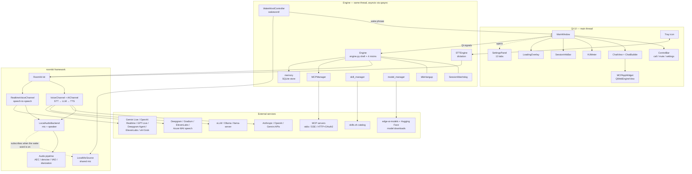

# Architecture

> _Generated: 2026-06-11 — updated 2026-10-11 for roomkit 0.97.0 — re-run /project-review to update_

RoomKit UI is a single-process desktop voice assistant. A PySide6 (Qt 6) GUI and an
asyncio engine share one thread through [qasync](https://github.com/CabbageDevelopment/qasync),
which drives the Qt event loop and the asyncio event loop as one. All voice, AI, and
audio-pipeline work is delegated to the [RoomKit](https://github.com/roomkit-live/roomkit)
framework; the app's job is wiring RoomKit's async events into Qt signals and back.

See [technical.md](technical.md) for implementation details, [features.md](features.md)
for user-facing behavior, and [onboarding.md](onboarding.md) to get a dev environment running.

## High-level overview

## Component breakdown

| Component | Files | Responsibility |
|---|---|---|
| **App bootstrap** | `app.py` | Graphics environment decided before PySide6 loads (Linux-only OpenGL probe, Chromium flags), `--doctor`, QApplication + qasync loop, logging, hotkeys, tray, wake word |
| **Optional backends** | `features.py`, `components.py`, `component_installer.py`, `widgets/install_offer.py` | Extras ↔ import probes ↔ install commands; a missing backend is reported, not raised as a fault, and offered for install: Settings → Models & components → Components, under the combo that picks it, in the chat after a failed start. The app installs only its own extras, pinned to its version, and only where it may (not a source checkout, not a frozen build) |
| **Engine shell** | `engine.py`, `engine_state.py` | Session lifecycle (`start` as its own task, `stop` cancels it), state machine (`idle/connecting/active/stopping/error`), model caching across sessions, kit build, ordered teardown |
| **Engine mixins** | `engine_vc.py`, `engine_realtime.py`, `engine_tools.py`, `engine_callbacks.py` | Mode-specific session builders, tool dispatch, provider→Qt callbacks. Mixins hold no state — all attributes live on `Engine` |
| **Session builders** | `engine_vc_helpers.py`, `vc_stt.py`, `realtime_providers.py`, `engine_audio.py` | Stateless builders: VC STT (and the turn VAD a turnless one needs)/LLM/barge-in/TTS filter/Smart Turn; realtime provider configs and per-provider audio wiring; AEC/denoiser/VAD/diarization/recorder pipelines |
| **Tools** | `toolset.py`, `builtin_tools.py`, `cli_tools.py`, `cli_exec.py`, `cli_help.py` | Tool grouping by source, channel options, built-ins, CLI tools seeded from `--help` |
| **Hooks** | `hooks.py` | RoomKit hook registration: transcriptions, audio levels, per-utterance speaker (VC), primary-speaker gating (VC), turn and voice errors |
| **VC agent** | `vc_agent.py`, `agent_hooks.py`, `widgets/settings/vc_agent_fields.py` | The Voice Channel agent's speak policy, thinker and background work, built from the Agent tab; their chat lines and the running-task count |
| **Watchdog** | `watchdog.py` | Detects unanswered speech (8 s, 90 s when tools are pending) and nudges the model |
| **Idle hang-up** | `idle_hangup.py` | Ends a session once the conversation goes quiet (never mid-tool-call, while a background task runs or while the assistant speaks) |
| **Cleanup** | `cleanup.py` | Purge of orphaned qasync/anyio timers and of the FD notifiers a session registered (prevents 100 % CPU) |
| **Memory** | `memory.py` | One durable room in a SQLite store (`conversations.db`, mode 0600), a recap for realtime sessions, the `recall_conversations` tool |
| **Wake word** | `wakeword/`, `widgets/wakeword_wizard.py` | Shared microphone lifetime, VAD-gated capture, whisper-encoder embeddings matched by DTW against an enrolled fingerprint |
| **Dictation** | `stt_engine.py`, `stt_sessions.py`, `hotkey.py`, `paste.py`, `paste_windows.py`, `tray.py` | Global hotkey → STT recording (OpenAI/local/Deepgram) → clipboard paste into the focused app |
| **Speakers** | `speaker_manager.py`, `enrollment.py`, `speaker_roster.py`, `speaker_naming.py`, `widgets/voice_name_dialog.py` | Speaker profile persistence (JSON) and embedding extraction for the local diarization; with Meta Muse, the voices it labels, the names put on them (a click in the chat, or the assistant's `name_speaker`), the user's voice for primary-speaker mode, and who is who in each turn's prompt |
| **MCP** | `mcp_manager.py`, `mcp_config.py`, `mcp_auth.py`, `mcp_app_bridge.py`, `url_policy.py`, `widgets/mcp_app_*.py` | MCP server connections (stdio/SSE/HTTP), OAuth2 flow, MCP App hosting (local server, request filter, JSON-RPC bridge) |
| **Skills** | `skill_manager.py`, `skill_git.py`, `skill_well_known.py`, `skills_sh_client.py` | Skill discovery from git/local sources, skills.sh search and installs, registry building via `roomkit.skills` |
| **Models** | `model_catalog.py`, `model_download.py`, `model_manager.py`, `download_flight.py` | Download/manage local STT/TTS/VAD/speaker/denoiser/turn models (GitHub LFS resolution, one download per model) |
| **Settings & secrets** | `settings.py`, `settings_secrets.py`, `secret_store.py` | QSettings persistence; API keys and secret env values in the OS keyring |
| **Providers** | `providers/`, `tts/` | Lazy factory registries for LLM providers and TTS backends |
| **Widgets** | `widgets/` | Main window, chat, VU meter, control bar, loading overlay, grouped settings workspace |

## Data flow

### Voice session (both modes)

1. `ControlBar` (or the wake word) asks `MainWindow` to start → `Engine.start(settings)`. The
   engine claims CONNECTING before its first await and runs the start as its own task, so a
   stop (the Cancel button on the loading overlay) can cancel it where it waits.
2. The engine builds the session from settings:
   - **Voice Channel mode** (`engine_vc.py`): STT provider (sherpa-onnx / Gradium / Deepgram / Azure MAI-Transcribe / Meta Muse) + LLM provider (Anthropic / OpenAI / Gemini / vLLM-Ollama / llama.cpp) + TTS provider (Piper / Pocket TTS / Qwen3 / NeuTTS / Gradium / ElevenLabs / Azure MAI-Voice) composed into a `VoiceChannel` plus an `AIChannel`.
   - **Realtime mode** (`engine_realtime.py`, builders in `realtime_providers.py`): `GeminiLiveProvider`, `OpenAIRealtimeProvider`, OpenAI GPT-Live, `DeepgramAgentProvider`, `ElevenLabsRealtimeProvider` or `XAIRealtimeProvider` (Grok) in a `RealtimeVoiceChannel`. ElevenLabs runs a fixed 16 kHz contract; the others stream 24 kHz.
3. Both modes use `LocalAudioBackend` (mic/speaker) and a pipeline built by `engine_audio.py`.
   Voice Channel: AEC, denoiser, VAD, optional diarization with enrolled speakers, optional
   Smart Turn detector. Realtime: AEC only — in the pipeline or at the transport, per
   provider — plus a WebRTC noise suppressor for Deepgram and GPT-Live; no VAD and no
   diarization. The stages run on one roomkit DSP worker thread (`DSP_THREADS = 1`); their
   callbacks come back to the loop. When the wake word is on, the backend subscribes to the
   shared microphone and replays what was said since the wake phrase.
4. Tools: CLI tools are probed and MCP servers connected, then grouped with the built-ins
   (`ToolSet`). At dispatch, engine built-ins (paste, end_conversation, set_attitude,
   recall_conversations) come first, then pure built-ins, CLI tools, MCP. If a realtime
   provider refuses the session config, the start is retried without MCP tools, on freshly
   built media.
5. RoomKit hooks (`hooks.py`) and provider callbacks (`engine_callbacks.py`) translate framework events into Qt signals: `transcription`, `mic_audio_level`, `speaker_audio_level`, `speaker_identified`, `tool_use`, `state_changed`, `error_occurred`, session notices and usage.
6. `Engine.stop()` publishes STOPPING, cancels a start still in flight, then runs the ordered teardown (`engine.py:_cleanup`): cancel owned tasks → end the voice session → close the session's own STT/TTS (cached models stay) → `kit.close()` (or close the backends directly when no kit exists yet) → close MCP and CLI children → forget the session → yield to the loop, then purge stale timers and the FDs the session registered. A failed start runs the same teardown before reporting ERROR.

### Dictation

Global hotkey (NSEvent on macOS, pynput elsewhere) → `STTEngine` records through a short-lived RoomKit session → final transcription → clipboard copy + paste keystroke into whatever app has focus (AppleScript on macOS; xdotool or wtype on Linux; Win32 `SendInput` on Windows). A press during a start or a stop is replayed once the transition settles.

### Wake word

While enabled, `WakeWordController` keeps a shared roomkit `LocalMicSource` running at the rate the next session needs. `SegmentCapture` resamples it to 16 kHz and cuts speech segments with a local VAD on a thread of its own; each segment goes to a serial worker that embeds it with whisper-tiny's encoder and matches it by DTW against the enrolled fingerprint. A match starts a session with a replay mark, so the request said right after the phrase reaches the provider. The listener stands down during sessions, dictation and while Settings is open. When the wake word is off, the source stops and sessions open the device themselves.

### Conversation memory

With **Remember conversations** on (default), every session joins one durable room in roomkit's `SQLiteStore`. The Voice Channel's AI rebuilds its context from the room; realtime providers (whose context starts blank) get a fenced recap of recent exchanges in the system prompt; the `recall_conversations` tool searches the whole history.

### MCP Apps

A tool result carrying a `ui://` resource URI triggers `MainWindow._fetch_and_show_app`: the HTML is fetched over MCP, served from a local `http://127.0.0.1` server with its own CSP, rendered in a `QWebEngineView` (one profile per widget), and wired to Python over QWebChannel JSON-RPC (`mcp_app_bridge.py`). App-initiated `tools/call` requests are proxied back through the engine's MCP path. An app whose session ended while it loaded is dropped.

## External integrations

- **AI providers**: Gemini Live + Gemini API, OpenAI Realtime, GPT-Live + API, Anthropic API, xAI Grok, Deepgram Voice Agent, ElevenLabs Conversational AI, vLLM/Ollama-compatible local endpoints, llama.cpp (roomkit downloads a pinned `llama-server` build and the GGUF model); ElevenLabs/Gradium/Deepgram/Azure MAI for voice.
- **MCP servers**: user-configured, three transports (stdio subprocess, SSE, streamable HTTP), OAuth2 with a localhost callback server for HTTP servers.
- **skills.sh**: public search endpoint used from settings; GitHub-backed results
  install through explicit git sources, while well-known results are downloaded over
  https into local skill folders after index/path validation.
- **edge-ai-models (GitHub)**: model distribution repo; downloads resolve Git LFS pointers to S3 URLs. Hugging Face serves the Smart Turn model and the wake-word encoder, each pinned to a commit and a SHA-256.

## Infrastructure & deployment

There is no server component. Distribution is a PyInstaller bundle built by GitHub Actions
(`.github/workflows/build.yml`, from a `v*` tag) for macOS (DMG), Linux (tar.gz), and
Windows (ZIP). The macOS app is signed and notarized only when the Apple signing secrets
are set; otherwise it is signed ad hoc. The same tag publishes the wheel to PyPI
(`release.yml`, Trusted Publishing) and, for a notarized app only, a Homebrew cask to
`roomkit-live/tap`. Both release workflows run CI (`ci.yml`: ruff, format check, bandit,
mypy, pytest, a Windows import check) as their first job, and refuse a tag that does not
match the project version (see [technical.md — Testing](technical.md#testing-strategy)).

## Security architecture

- **API keys, OAuth tokens, MCP OAuth client secrets, and secret-looking env values of MCP servers and CLI tools** are stored via `SecretStore` (`settings_secrets.py`): OS keyring first, with a QSettings fallback when no keyring backend is usable or a write was refused. MCP OAuth tokens are bound to the server URL they were issued for and dropped if it changes.
- **MCP stdio servers** are launched as subprocesses from user-entered commands (list form, no shell). The SDK inherits only a small default environment; RoomKit UI passes only explicitly configured env values (plus a search `PATH`), with secret-like values removed from plaintext settings.
- **CLI tools** run a declared binary with arguments the model chooses, with the user's permissions, without asking; the settings page says so. No shell is involved.
- **Skills are arbitrary code/instructions** loaded from git repos or local folders. skills.sh is used for discovery; GitHub-backed marketplace results become explicit Git sources (git runs bounded in time, without prompts, isolated from any inherited `GIT_DIR`), and well-known marketplace results become local sources fetched over https only, under byte caps. v0.2 `skill-md` well-known artifacts are checked against their SHA-256 digest, but legacy `files[]` well-known sources do not provide signatures — installation is still the trust decision.
- **MCP App HTML** runs inside QWebEngineView with the same-origin policy on (never `--disable-web-security`) and a request filter: a request or an opened link must target a public host — every address the name resolves to globally routable, numeric IPv4 forms parsed as a browser does (`url_policy.py`). App-initiated tool calls are limited to the owning MCP server.
- **Conversation history** (`conversations.db`) is created readable by its owner only (0600), side files included. Past lines reach a realtime prompt fenced as a record, not as instructions.
- **Session recordings** are plain WAV files in a folder the user picks; the settings say they are not encrypted.
- Input boundaries: tool arguments arrive as JSON and are passed to MCP servers verbatim; built-in tools validate their own inputs.

Known gaps (documented honestly): GitHub release-asset models (GTCRN, speaker embeddings)
publish no digest and are only checked against their size; MCP stdio servers and CLI tools
run with the user's full trust. See [technical.md — Technical debt](technical.md#known-technical-debt).

## Scalability considerations & current limits

- **One voice session at a time** — enforced by the engine state machine; a second `start()` while non-idle is ignored.
- **Single process, one UI + async thread**; the audio DSP chain runs on one roomkit worker thread, the wake word's VAD and encoder on threads of their own, and blocking work (model downloads, paste and CLI subprocesses, git) on executor threads. The llama.cpp server runs on its own thread and event loop.
- Local models are cached across sessions (STT/TTS/diarization/Smart Turn keyed by config) to avoid multi-second reload on every call; the llama.cpp server outlives sessions.
- The fixed 420×700 window and single-room design are deliberate product constraints, not technical ones.
