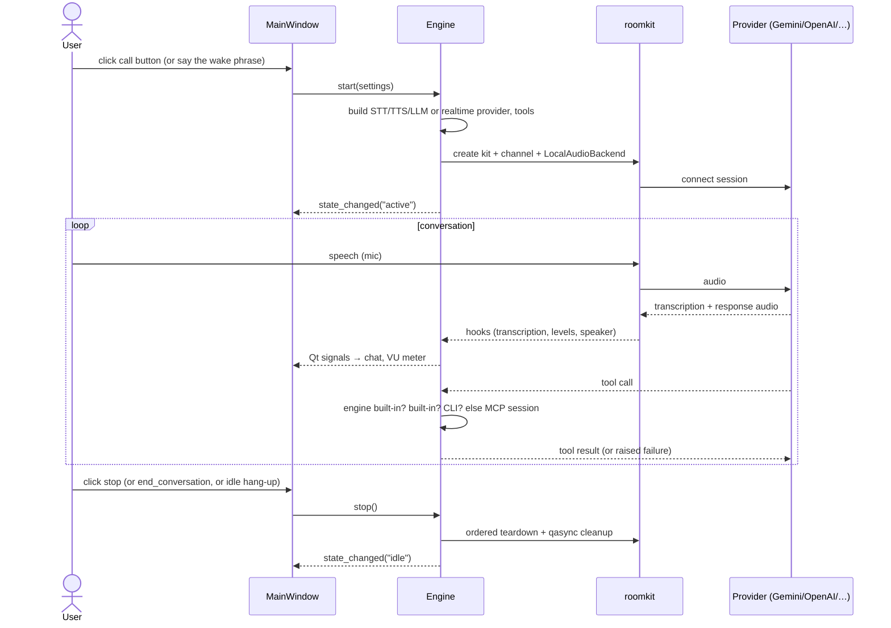
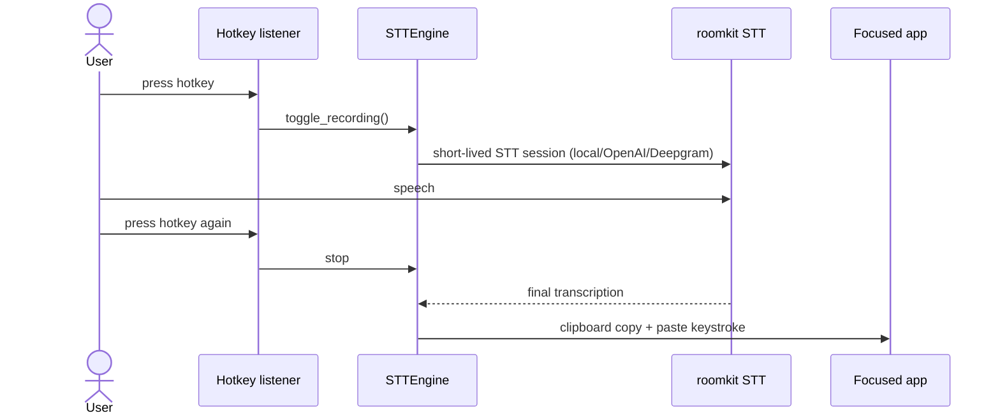

# Features

> _Generated: 2026-06-11 — updated 2026-10-12 for roomkit 0.99.0 — re-run /project-review to update_

Implementation details for each feature are in [technical.md](technical.md);
system context in [architecture.md](architecture.md).

## Core features

### Voice conversation — two modes

| | Realtime (speech-to-speech) | Voice Channel (STT → LLM → TTS) |
|---|---|---|
| Providers | Gemini Live, OpenAI Realtime, OpenAI GPT-Live, Deepgram Voice Agent, ElevenLabs ConvAI, xAI Grok | LLM: Anthropic, OpenAI, Gemini, local (vLLM/Ollama), llama.cpp |
| STT | provider-native | sherpa-onnx (local), Gradium, Deepgram, Azure MAI-Transcribe, Meta Muse, Google Gemini |
| TTS | provider-native | Piper and Pocket TTS (local), Qwen3-TTS & NeuTTS (voice clone), Gradium, ElevenLabs, Azure MAI-Voice, Google Gemini |
| Latency | lowest | depends on the three stages |
| Offline capable | no | yes (local STT + local LLM + Piper or Pocket TTS) |
| Usage shown | tokens | tokens + cost estimate (catalog pricing) |
| Code | `engine_realtime.py`, `realtime_providers.py` | `engine_vc.py`, `engine_vc_helpers.py`, `vc_stt.py` |

Both modes share: echo cancellation (WebRTC/Speex), barge-in interruption, optional WAV
recording, MCP + CLI + built-in tools, skills, attitudes, conversation memory, and the
wake word. Voice Channel only: noise suppression (RNNoise/GTCRN), VAD (TEN/Silero),
speaker diarization, the Smart Turn detector, barge-in modes and TTS filtering. A
realtime session started with diarization enabled runs without it and says so in the chat.

A missing backend never fails silently: the provider is marked in Settings with an
Install button under it, and a session started with it offers the same Install in the
chat; Settings → Models & components → Components lists them all (`features.py`, `components.py`).

### Realtime providers

- **Gemini Live** — options follow what the selected model takes (roomkit's
  `live_model_profile`). On the 3.8 family "AI can speak unprompted" and "Emotional
  responses" are disabled with a tooltip saying why; `gemini-3.8-live-extended-thinking`
  gets a Thinking level; the family gets transcription options (language may change
  mid-conversation, language hints, a custom vocabulary).
- **OpenAI Realtime** — reasoning effort (gpt-realtime-2+), voice speed (0.25–1.5).
- **OpenAI GPT-Live** — full-duplex: it listens while it speaks, can backchannel, and
  hands reasoning and tool calls to a backend model OpenAI hosts ("Tools Model" and its
  effort, gpt-5.6-terra at low by default). Shares the OpenAI key field.
- **Deepgram Voice Agent** — listen/think/speak composition: STT model, language,
  think provider and model, the TTS vendor Deepgram hosts (Aura, ElevenLabs, OpenAI) with
  its voice and speed, and an opt-in half-duplex mode that mutes the mic while the agent
  speaks.
- **ElevenLabs Conversational AI** — agent ID; model, voice and turn detection live on
  the dashboard agent.
- **xAI Grok** — server-VAD tuning (threshold, silence, prefix padding).

Model and voice lists come from roomkit's offline catalogs; a saved id outside the list is
kept, never replaced. Agent Skills reach realtime sessions as well as Voice Channel ones.

### Voice Channel details

- **Model lists** from roomkit's catalogs (Claude, OpenAI, Gemini). Claude defaults to
  Claude Sonnet 5.5 and Gemini to Gemini 3.8 Flash; a stored retired default moves to the
  new one once, and the chat says so. A deprecated model the user picked is kept, with a
  notice at each session.
- **llama.cpp** — a Hugging Face `repo:quant` or a `.gguf` file; roomkit downloads a
  pinned `llama-server` build (SHA-256 checked) and the model, and the server outlives the
  session (one per model and context size).
- **Local model thinking** — "Model thinking (slower answers)", off by default, for vLLM,
  Ollama and llama.cpp: a reasoning model otherwise thinks for seconds before a spoken
  reply. A model that always reasons cannot be switched off; the hint says so. Its
  reasoning is never spoken. On llama.cpp the setting rides each request (the running
  server serves both), and a turn that thinks may fill the context window.
- **Thinking and effort** (Think · LLM, Claude and Gemini) — Claude: Thinking (model
  default / on / off) and Effort (model default, low to max), set apart since effort also
  shapes the answer with thinking off. Gemini: one thinking level, Off included. They
  reach roomkit's `AIChannel` as `enable_thinking` / `reasoning_effort`
  (`engine_vc_helpers.reasoning_options`), and roomkit sends each model what it takes: a
  model that always thinks runs at its lowest level for Off. Every cloud LLM turn gets
  `max_tokens` 16k (64k at Extra high and Max): roomkit's 1024 cut replies and tool
  calls, since reasoning counts against it and Claude 5.x and Gemini 3.x reason when
  nothing is set. A local model keeps its server's budget. The note under the fields
  reads roomkit's catalog for what the selected model does differently. OpenAI has none:
  a voice turn carries tools, and with tools roomkit sends GPT-5.4 and later no reasoning.
- **Pocket TTS** — Kyutai's local voice, CPU-friendly, in English, French, German,
  Spanish, Italian, Portuguese and Dutch (larger variants for all but English). By default
  it speaks the speech-recognition language (English when Pocket has no model for it); a
  pre-made voice or a WAV to clone (cloning needs the gated `kyutai/pocket-tts` weights).
- **Azure MAI-Transcribe / MAI-Voice** — Microsoft Foundry speech, one resource and one
  key for both. MAI-Transcribe finds no turns itself, so the session always gets a VAD
  (the chosen model, else an energy VAD) with an 800 ms end-of-turn silence by default.
- **Meta Muse Voice Transcribe** — streaming STT on Meta's Model API (25 languages,
  French included). The model ends each turn itself, after about 550 ms of silence,
  so the session gets no VAD. The speech-recognition language becomes a bias (none
  set: Muse takes what it hears); a language Muse does not list (Russian) is refused
  at start. Optional keywords bias it toward names and terms.
- **Google Gemini STT / TTS** — on the Gemini key Gemini Live and the LLM use, so one
  key can run the whole pipeline. The STT is Google's live recogniser
  (`gemini-3.5-transcribe-live`): it streams words while the user speaks and ends each
  turn itself, so the session gets no VAD; the speech-recognition language is its hint
  (none set: it detects among 85+), and an optional vocabulary biases it toward names.
  The TTS defaults to `gemini-3.8-flash-lite-tts`, built for voice agents (3.8 Flash
  acts more, about half a second later), with the 30 prebuilt voices or any id from
  Google's catalogue and an optional style ("warm and calm"). It takes the whole reply,
  not each sentence as it is written, and speaks the reply's language.
- **ElevenLabs streamed input** — "Stream text to ElevenLabs (lower latency)", on by
  default: each sentence is synthesized as soon as it is written (v4 / v4 Turbo and the
  v2 / v2.5 models). v4 is the default model; v3 has no streaming socket and keeps
  whole-reply synthesis.
- **Barge-in** (Settings → Conversation → Voice setup → Voice Channel → Listen · STT) — Off (the assistant finishes), Any
  speech interrupts, or Words only: roomkit's semantic strategy with its
  `PhraseBackchannelDetector`, so "ok", "mm-hmm", "d'accord" or "merci" let the assistant
  go on while other words stop it. With a streaming STT, sound without words never cuts
  in. A non-streaming (Whisper-type) local STT has no words before the speech ends, so
  there any speech that lasts stops the assistant; the Settings hint says so. It sits with
  the STT because what it can do depends on the STT.
- **TTS filtering** — the voice skips emoji, a JSON object the model wrote instead of
  calling a tool, notes to itself ("(Note: …)"), separators and bracketed stage
  directions; the chat shows the same filtered text. On a voice that performs audio tags
  (ElevenLabs v3, v4, v4 Turbo; Google Gemini), brackets pass through: "[laughs]" is a
  cue there.
- **Audio tags** (Speak · TTS → "Let the assistant direct its voice", off by default) —
  the system prompt hands the model the tags its voice performs ([laughs], [sighs],
  [whispers], [excited]…; `audio_tags.py`) to use where they fit, so the delivery varies.
  Enabled only for a voice that performs them; any other would read them aloud. The chat
  shows the tags as written.
- **Smart Turn** (`smart-turn` extra) — a turn detector that judges from the audio whether
  the user has finished; "Unfinished Wait (ms)" sets how long an unfinished turn waits for
  more speech. Without the extra the setting reads "not installed", and a session runs
  without it and says so.
- **Turn failures in the chat** — a turn the LLM could not answer (bad key, quota), a TTS
  or STT failure, and a local model without tool support each show a line in the chat. A
  transient provider refusal is retried twice before that.

### Voice Channel agent (Settings → Conversation → Voice setup → Voice Channel → Agent)

Three add-ons, all off by default. One that cannot run is left out of the session;
none fails the start. An unavailable speaking policy is explained in session details
and logs; the other add-ons report their absence in the chat.

- **Deciding when to speak** — roomkit's `ClassifierSpeakPolicy`: on each turn one
  classifier call judges whether the speaker finished, put it off, asked for quiet or
  spoke to the assistant, and the assistant answers, offers one short sentence, or stays
  quiet. These decisions stay in the logs. "Just listen" keeps it
  listening until spoken to by its name (the tab's Name field, "Assistant" by default).
  The judgments come from OpenAI Decisions (the OpenAI key), TypeSafe Jev (`typesafe`
  extra and key) or the conversation model (one that answers under a JSON schema). Every
  reply waits for the decision; a classifier that fails or misses roomkit's 2 s bound lets
  the assistant answer, with the fallback recorded in the logs.
- **Thinking while listening** — needs a speaking decision. On the turns the assistant
  stays quiet, the conversation model rewrites its thought (what is said, what it could
  add); with something worth saying it may offer it. Thoughts go to the log only.
- **Background work** — the assistant gets roomkit's `work_in_background` tool: a long
  request runs as a task, in a room of its own, with the same tools, while the
  conversation goes on; the result comes back as a turn it speaks. The chat shows when a
  task starts and how it ended, and the idle hang-up waits for running tasks. Needs a model
  given tools (not a local model set without tool use). "Tasks run on" picks the model:
  the conversation's (the default), or any LLM Think · LLM offers — Anthropic, OpenAI,
  Gemini, a local vLLM/Ollama server or llama.cpp — with its fields below it. A cloud
  model starts on Think · LLM's and uses that provider's key; a local field left empty
  takes Think · LLM's value. On a cloud model of its own a task reasons as that model
  does by default (Think · LLM's thinking and effort are set for spoken replies), and a
  local model's Model thinking is on by default since nobody waits on a task's first word.
  A llama.cpp server starts while the session opens, without holding it up (the chat
  says if it cannot); the same GGUF and context as Think · LLM share one server, a
  different one runs beside it. The session details list the model as "Background
  tasks · LLM". Not installed or without its key, the tasks stay on the conversation
  model, and the chat says why. Whatever the model, a task is not given
  the tools that act on the live conversation or the desktop (`toolset.SESSION_TOOLS`:
  hang up, attitudes, voices' names, paste); roomkit refuses one called anyway.

The session's cost counts the background tasks' turns, priced as the model they run on,
but never the classifier's or the thinker's.

### Wake word

Settings → Wake Word. Detection runs locally and continuously; nothing leaves the
machine until the phrase is heard, which opens a session. It compares sound to sound — no
transcription — so the phrase works in any language.

- **Enrolment** — a guided wizard records the phrase said normally, more quietly and
  from further away, then words that sound close and must not wake it; the threshold is
  measured between the two, and the wizard says when they overlap and suggests a more
  distinctive phrase. Components & local models on this page offers the whisper-tiny
  encoder (~12 MB) and TEN VAD, using the same progress and retry state as the library.
  Closing Settings does not interrupt a download. Recording and forgetting a phrase
  update it immediately; recording uses pending microphone/provider choices.
- **Sensitivity** — Cautious, Balanced or Responsive, scaling the measured threshold.
- **Replay** — the request said right after the phrase reaches the provider: sessions
  subscribe to the shared microphone and replay from the wake mark (both modes, when the
  microphone's rate fits the session).
- **Auto-hangup** — "Automatic hangup" after a set number of
  seconds (15 by default), never while a tool call is in flight or the assistant speaks;
  the wake word then listens again. Set on this page, it applies to every session, and
  the chat says why the session closed.
- The listener stands down during a session, during dictation and while Settings is open.
  With the wake word off, the shared microphone is released.

(`wakeword/`, `widgets/wakeword_wizard.py`, `idle_hangup.py`, `wakeword` extra)

### Conversation memory

Settings → Privacy & memory → "Remember conversations", on by default. Each thread
has its own room in `conversations.db` (readable by its owner only), title, transcript
and tool results. Hanging up retains the thread. The top-left history icon opens a
full-width sliding panel with **Recent** (the 30 most recently active threads), search
across all conversation titles, **New conversation**, and **Settings** at the bottom;
opening an existing thread never starts audio. Press Live to continue it. Switching
threads is available once Live ends. Old shared history is imported once as **Earlier
history**, without changing its source events.

The first user message supplies a provisional title. After the first exchanges, one
background request asks the configured text model for a short subject in the user's
language: the selected LLM in Voice Channel, or the corresponding Gemini/OpenAI text
model in Realtime. Other realtime providers, unavailable models and failed requests
keep the provisional title. **⋯ → Rename** or **F2** sets a name that automatic titles
cannot overwrite. Renaming does not reorder recent activity. Private threads keep
their titles in memory too. (`conversation_titles.py`)

**⋯ → Delete…** or the **Delete** key (Backspace on a Mac keyboard) removes a thread
after a confirmation, Cancel by default: its snapshot, RoomKit's room for it (every
event and the search index `recall_conversations` reads) and the rooms its background
tasks ran in, then compacts the database so the deleted text does not linger in its
free pages. Deleting the open thread empties the chat. A text session waiting for the
next message is closed first; Live must end before. (`ConversationStore.delete`,
`memory.delete_room`)

Both modes receive a fenced recap of only the selected thread (up to 50 messages and
24,000 characters), and `recall_conversations` searches only its room. Earlier requests
are context rather than new commands; cut answers are marked interrupted. Voice Channel
uses `session_window` for the current Live call, so older calls do not enter context
twice. The recap survives attitude changes. With history saving off, new exchanges
stay in memory until the app closes, including when continuing a saved thread; that
thread's saved version stays intact. (`conversations.py`, `memory.py`,
`widgets/conversation_history.py`)

### System-wide dictation

Press a global hotkey anywhere in the OS, speak, then press again — the transcription is pasted
into the focused application (macOS, Linux X11/Wayland, Windows). STT can be local
(sherpa-onnx models), OpenAI, or Deepgram. A tray icon shows recording state; a press
during a start or a stop is replayed once it settles. A single-modifier hotkey fires only
on a tap, not when the modifier is part of a chord. (`stt_engine.py`, `hotkey.py`,
`paste.py`, `paste_windows.py`)

On macOS, automatic paste uses System Events and may need permission in Privacy &
Security → Accessibility and Automation → System Events for RoomKit UI (or the terminal
launching a checkout). If the paste is refused or times out after copying, the transcript
remains on the clipboard for manual ⌘V. The app reports this and does not retry the
keystroke automatically, because a timeout does not prove that nothing was inserted.

### Speaker diarization & primary-speaker mode (Voice Channel only)

**With Meta Muse as the STT**, Muse tells the voices apart itself, live: no speaker
model, no enrolment. The chat shows each turn under its voice ("Speaker A", "Speaker B",
in the order they first speak), and a change of voice ends a turn. Naming them:

- **A plain click** on a voice's name above its bubble asks who it is: a name typed, or
  picked among the enrolled speakers and the names given this session. Every turn of
  that voice, past and to come, takes the name.
- **The assistant** names those who introduce themselves ("I'm Julie") with its
  `name_speaker` tool, shown as "Speaker B → Julie". It never renames a voice you named,
  never gives your name or a name another voice carries, and takes plain names only.
- **The first voice is you** (Settings → Audio & voice → Speaker recognition, on by default): you open the session,
  so the first voice takes your name ("Your name", else the primary speaker profile's).
  Whoever speaks first is taken as you, though; a click puts it right.

Each turn's prompt ends with who is who once two voices have spoken, so the turns said
under a label before it was named still read as that person. *Primary speaker mode*
lets through only the voice carrying your name, and nothing while none does. Muse knows
nobody from one session to the next; a stream that starts over (after an hour, or an
error) tells the voices apart afresh ("Speaker A#1"), and the names are to give again.
(`speaker_roster.py`, `speaker_naming.py`, settings → Audio & voice → Speaker recognition)

**With local STT**, enroll speakers from a 10 s recording (split into overlapping windows for robust
embeddings) on the microphone sessions use. During a session each utterance is attributed
to the voice heard longest over it: the chat labels the enrolled name or "Unknown", and
the model reads the speakers' names once several people talk. *Primary speaker mode*
makes the assistant answer only utterances attributed to the enrolled primary speaker.
(`enrollment.py`, `speaker_manager.py`, `hooks.py`, settings → Audio & voice → Speaker recognition)

### Tools: MCP + CLI + built-ins + MCP Apps

- **Session details**: the Live header's information icon opens a full-width panel
  matching conversation history. It groups the current model/personality, reported
  token usage and cost, tools, skills, assistant behavior and unavailable integrations.
  Search names or descriptions; expand entries to read their full descriptions.
  Updates preserve the search and expanded entries. Opening the panel leaves audio
  running and the transcript's layout intact; hangup closes and clears it.
- **Activity in Live**: compact rows show each tool's readable name and actual state
  (working, done, failed or stopped). Click a row to inspect its input and result;
  details are selectable plain text, with a bounded preview for large outputs.
  Interactive MCP output shares the same row. Repeated calls keep separate results.
- **Built-in tools** (always available): date/time, RoomKit info, attitudes (list, set),
  clipboard paste, end-conversation (only on an explicit goodbye), and
  `recall_conversations` when memory is on. (`builtin_tools.py`, `engine_tools.py`)
- **CLI tools**: declare a local binary once (Settings → Integrations → CLI tools) and the model can run
  it, its `--help` seeded into the tool description. The page warns that a declared CLI
  runs with the user's permissions and any arguments the assistant chooses, without
  asking — unless a skill an MCP server serves is active (below). (`cli_tools.py`,
  `cli_help.py`)
- **MCP servers**: stdio / SSE / streamable-HTTP transports, configured in
  Settings → Integrations → MCP servers. HTTP authentication offers None, Bearer token,
  raw Authorization API key, Basic username/password or OAuth 2.0. Secret fields are
  masked; extra headers live under Advanced options and use the same secret store.
  Older Authorization headers populate the matching method automatically; OAuth owns
  its Authorization header, and choosing None removes it. Missing credentials are
  explained before connecting. An MCP tool named like a built-in or CLI tool, or with a
  name providers refuse, is left out and named in the chat. A session speaks the 2026
  protocol when the server offers it, the initialize handshake otherwise. (`mcp_manager.py`)
- **Skills from MCP servers** (MCP Skills extension, SEP-2640): a server that publishes
  skills brings them beside the user's own, named after it (`hugging_face:hf-cli`), in
  both modes. The model sees their names and descriptions; a skill's text is read from
  its server when the model activates it, checked against the listing, and given as that
  server's content. While one is active, a CLI tool runs only once the user allows it for
  the conversation ("Allow this skill to run programs?", Refuse by default, refused after
  60 s without an answer). "Use its skills" on a server's page turns them off; a listing
  that fails or a skill roomkit refuses is named in the chat. (`mcp_skills.py`,
  `skill_approval.py`, `widgets/skill_approval_dialog.py`)
- **Instructions from MCP servers**: what a server publishes on using its tools (dice to
  resolve, names it accepts, which skill unlocks which tools) reaches the model in every
  mode the server's tools do — Voice Channel, its background tasks, typed turns,
  realtime — after the user's prompt, under the server's label and set apart as that
  server's content. An attitude or the memory recap leaves them in place, once, and Tool
  Search does not hide them. "Pass its instructions to the model" on a server's page
  turns them off. (`mcp_manager.py`, `toolset.py`)
- Dispatch order: engine built-ins, built-ins, CLI tools, then the owning MCP session. A
  failed call is reported to the model as a failure on every provider.
- **Tool search** (Settings → Integrations, below the tabs): with many tools, roomkit
  shows the model a few and hides the rest behind `find_tools`. Automatic (the default)
  decides on roomkit's thresholds, each editable: a realtime model searches above 20
  tools and sees at most that many at once; the Voice Channel's model searches once the
  tools' schemas pass 8000 tokens or 10 % of its context window (the tool count when the
  window is unknown). A local model (Ollama, vLLM, llama.cpp) gets every tool in its
  prompt: Automatic never searches for it. Always search and Never force it either way.
  The built-ins always stay visible. (`toolset.tool_search_options`)
- **MCP Apps**: tools that declare a `ui://` resource render their HTML UI inline in
  the chat (QWebEngineView + JSON-RPC bridge) and can call tools back through the app;
  they cannot reach local or LAN services. (`mcp_app_bridge.py`, `widgets/mcp_app_widget.py`)
  Their pages and original results now reopen with saved conversations, including
  after restarting RoomKit. History viewing needs no MCP connection and does not
  repeat the tool call. Server actions remain available during the active session;
  historical output stays readable after it ends.
  Data fetched by the page itself is saved too, so views such as the dice tray
  can retrieve their original display data when reopened.

### Images the assistant draws (Settings → Conversation → Images)

Off by default. Picked a provider (OpenAI, Google Gemini, xAI Grok or Meta Muse) and
its model from roomkit's catalog, the assistant gets a `generate_image` tool in every
mode, spoken or typed. Asked for a picture, it draws one and the image shows in the
chat as its entry, kept in the conversation's history; it then says in a few words
what it drew. The assistant sees what it drew: the tool gives it the image's id,
size and dominant colours (so "set my lights to its colours" needs no guess) and a
copy at most 768 px long; roomkit keeps the latest two in view on the next turns.
`edit` changes an image of the conversation, the latest (one the user shared or one
it drew) or a drawing by its id. It uses the provider's key from Providers & keys; a provider
not installed or without its key leaves the tool out, and the chat says why. Each
image is billed by the provider and one that fails is never drawn again on its own
(roomkit's rule); an image billed before a failure is still shown. The session's cost
counts an image when roomkit's catalog prices the model (OpenAI, Gemini). Any image in
the chat, drawn or shared, opens larger on a click, with a Save… button; a right-click
offers Save image…. The file is the image as the chat keeps it (PNG or JPEG).

### Skills & attitudes

- **Skills**: instruction packages discovered from git repos or local folders;
  Settings → Integrations → Skills shows installed skills, with **Browse skills.sh**
  at the top and **Manage sources** for folders/repositories. The online catalogue
  searches skills.sh through its public search endpoint. GitHub-backed
  results install as explicit Git sources; well-known results install over https into
  local skill folders after validating the public discovery index, then skills are enabled
  per-skill and registered into roomkit's `SkillRegistry`, in both modes.
  (`skill_manager.py`, `skill_git.py`, `skill_well_known.py`, `skills_sh_client.py`)
- **Attitudes**: persona presets (plus user-defined ones) appended to the system prompt;
  switchable mid-session by the user *or by the model itself* via the `set_attitude`
  tool. (`engine_tools.py`)

### Local model management

Settings → Models & components → Local models manages local models: STT (Whisper, Parakeet, Zipformer,
Kroko-FR), TTS (3 Piper French voices, espeak-ng data), VAD (TEN, Silero), speaker
embeddings (TitaNet, WeSpeaker, CAM++), GTCRN denoiser, Smart Turn v3.2 and the wake-word
encoder. Downloads resolve
GitHub LFS pointers, give up on a stalled connection, and run once per model even if
Settings is reopened mid-download; GPU inference (CUDA/CoreML) is selectable.
The catalogue groups models by use and filters by name, category and download status.
Download progress belongs to the application and reappears when Settings is reopened;
failed downloads expose an error and Retry. Downloading files does not change the chosen
provider or model. Links from Conversation, Dictation, Audio & voice and Wake Word open the library
while keeping pending edits. Global search can reveal an individual model or component.
(`model_catalog.py`, `model_download.py`, `model_library.py`, `model_jobs.py`, `models_page.py`)

The Components tab lists the dependencies separately, with name and installation filters.
It preserves automatic installation, command copying in a source checkout, bundled-build
restrictions, conflict confirmation and cancellation. Installation output is expandable;
the last outcome and any required restart remain visible after reopening Settings.

### Diagnostics

Settings → Privacy & memory controls session recording and its output folder. Recordings
are plain, unencrypted WAV files. Settings → Diagnostics groups three tabs:

- **Recorded audio** searches both output folders by name and source, showing up to
  100 matching WAV files, newest first. It plays files with QtMultimedia (the `mcp-apps`
  extra), opens either folder and confirms deletion of the displayed selection only.
  Changed files are preserved and failures are reported. Playback stops when leaving
  the browser. Pending output-folder edits are used without saving Settings first.
- **Pipeline capture** enables debug taps and selects all or individual processing
  stages. Clearing the last selected stage turns capture off; re-enabling requires
  selecting a stage. Capture writes unencrypted WAV files from the next session.
- **Telemetry** selects disabled, local logs or OpenTelemetry export. OTLP settings
  retain their values when disabled, show the gRPC/HTTP default endpoint and offer
  installation guidance when the component is missing. Changes apply to the next session.

About shows the installed application version and runtime, copies those details for
support, links to the project website and keeps the complete MIT license in a disclosure.

### UI

Compact chat window (420 px wide, height resizable): the user's turns in a subtle bubble, the assistant's
text typeset in the column and rolling out with its voice, cut back to what had been said
(estimated from the audio played) with an "— interrupted" mark when roomkit's barge-in
stops the voice (speech it lets through, with barge-in off or an "ok", leaves the reply
whole); markdown; animated VU meter; a sliding session panel with tools, skills and
reported usage. The panel lists the active STT, LLM, TTS, voice, speaking decision and
thinker models. Realtime shows integrated audio, separate transcription or delegated
reasoning when used, and Deepgram's three stages. ElevenLabs agent models managed remotely
are identified as not reported. Model details come from the resolved backends, including
their defaults; searching tools hides the overview until the search is cleared.
The composer starts on one line, grows to eight visual lines, then scrolls vertically.
Enter or the arrow sends; Shift+Enter adds a line, and pasted text keeps its line breaks.
It uses the LLM chosen in
**Settings → Conversation → Text chat**: by default the Voice Channel's (Think · LLM),
including when Live is set to Realtime, or a model of its own from the same providers,
with the same instructions, tools and memory. A cloud model of its own reasons as it
does by default; a local one has its own tool-use and thinking switches, and llama.cpp
keeps a server for typed messages beside the voice's when their GGUF or context differ.
Until that provider has its required key/model and installed backend, the input stays
grey with **Configure chat in Settings…**; its tooltip identifies what is missing. Closing Settings refreshes it immediately. This local check does not test
credentials or contact a server. An empty draft keeps the Live button; while a written
response streams, the button stops generation and retains all received text. A following
draft can be prepared during generation. Text uses the selected thread's context, tools,
instructions and history preference without opening microphone, STT or TTS. The `+`
menu offers **Choose images** and **Take a photo**. Images can also be pasted directly
into the input with Cmd/Ctrl+V or dragged onto the composer. Up to four images appear
as removable previews; click one to open it. Send images alone or with a message.
The camera opens only on request, offers **Retake** and **Use photo**, and stops after
capture or cancellation. Missing camera support offers the `camera` component; access
denied and missing devices have explicit feedback. PDFs remain unavailable.
Known text-only models show a setup hint; local endpoints decide
whether their loaded model accepts images. While Live, an image button
beside the mic shares one the same way (file or camera): it shows in the chat as the
user's, and the assistant answers aloud. On the Voice Channel it is the user's turn,
read by a Think · LLM model that sees; on a realtime voice it goes into the session
(Gemini Live, OpenAI Realtime). Otherwise the button is greyed, with the reason.

The small microphone dictates into the draft using **Settings → Dictation** (OpenAI,
Deepgram or a downloaded local model), its language and the selected input device.
Click to start, then click again to finish; the text is inserted at the cursor or replaces
the selection, with an ordinary Undo. It remains editable before sending with any images.
Preparing, listening and transcribing have compact feedback and a cancel button. Cancel
retains the existing draft; errors leave it editable. Missing STT setup disables only
the microphone. A chat model is required, as for typing. Dictation shares the microphone
with the global shortcut; Live, sending, Settings and thread changes wait until capture
and cleanup finish. It never sends a message, touches the clipboard or uses Accessibility,
and works even with the global shortcut disabled.

Image imports accept PNG, JPEG, WebP, GIF, BMP and HEIC where Qt has the decoder.
The first frame is normalized to PNG/JPEG, resized to a maximum 2048-pixel edge and
stripped of embedded metadata. Sources are limited to 20 MB; each prepared image is
at most 4 MB. Saved history contains the prepared bytes, so deleting the original file
does not break the conversation; private threads never save images to disk. Resuming
a typed session provides its four most recently shared images as visual context.

MCP connections, session details and
interactive tool outputs stay available between replies, including after stopping a
generation. Changing conversations, opening Settings, starting Live or closing the app
releases that text session and its embedded apps.
The Live header contains only history and information actions. Startup progress appears
within the conversation area, with a Cancel button. Other features include dark/light
themes, synthesized start/stop sounds and a watchdog that nudges a model that left the
user's speech unanswered. Settings is a resizable workspace with grouped navigation. General contains appearance
and shortcuts; Conversation groups voice setup and personality; Audio & voice groups
devices, processing and speaker recognition. Providers & keys is the single editor for
provider credentials, shared by conversation and dictation. The footer explains that
Done, Escape and closing the window save pending edits. Light/dark theme changes apply
and persist immediately across existing widgets and chat messages. Popup menus share
the Settings palette, rounded corners and violet selection, including the image menu,
conversation actions and built-in editor context menus. Search (Ctrl/Cmd+K
or Ctrl/Cmd+F) recognizes setting names and English/French aliases, opens the matching
page/tab/disclosure, and focuses the control. Search indexes no entered values; dependent
settings explain their prerequisites without changing a provider or mode. Escape clears
an active search first.

Integrations brings Skills, MCP servers and CLI tools into one destination. Searchable
lists expose add, edit and remove actions, with setup/availability status; enabled does
not mean connected. Forms separate main fields from advanced configuration and retain
edits when switching tabs. Installed skills can be filtered by name and activation;
removing a skill source keeps its files on disk. OAuth feedback follows its server and
URL, and downloading or updating a source reports on that source even if another is open.

The spoken language lives in General: every conversation's STT transcribes in it (none
set: detected, sentence by sentence). Listen · STT links to it. Dictation follows it unless
its own Dictation language sets another or Auto-detect.

Dictation separates activation and shortcut from transcription choices. Missing backends
offer installation; unavailable local models retain their saved ID until replaced by the
user. The translation control appears for local Whisper and keeps its value when hidden.
Wake Word separates activation, phrase recording, prerequisites and quiet-conversation
hangup; sensitivity choices have short labels and explanations. Search reveals unavailable
controls through an explanation and their prerequisite, preserving the current preferences.

## User roles & permissions

Single-user desktop app — no roles, no auth. The OS user owns all data
(settings, conversation history, speaker profiles, wake-word fingerprint, models, tokens).

## Workflows

### Voice session

### Dictation

## Integration points

| Integration | Direction | Notes |
|---|---|---|
| Gemini Live / OpenAI Realtime / GPT-Live / Deepgram Agent / ElevenLabs / Grok | bidirectional WS | speech-to-speech |
| Anthropic / OpenAI / Gemini / vLLM / Ollama APIs | outbound | voice-channel LLM turn |
| llama-server (local) | local HTTP | roomkit downloads the server build and the GGUF model |
| ElevenLabs / Gradium / Deepgram / Azure MAI / Gemini | outbound | cloud TTS / STT |
| MCP servers | bidirectional | user-configured; Bearer, raw API key, Basic or OAuth2 for HTTP |
| skills.sh | outbound HTTPS / browser | skill search; GitHub sources install as Git, well-known sources as local folders |
| edge-ai-models GitHub repo, Hugging Face | outbound | model downloads (LFS; Smart Turn and the wake-word encoder pinned by SHA-256) |

## Current limitations

- One session at a time.
- Text and image messages need a configured conversation LLM; image understanding
  also needs vision support in the selected model. The composer explains missing setup.
- Realtime mode requires a cloud provider; no local speech-to-speech.
- Realtime sessions run without speaker diarization (primary-speaker gating drops the
  audio before the pipeline that would diarize it).
- The Voice Channel agent's add-ons (speaking decision, thinking, background work) are
  Voice Channel only: a realtime model takes its own turns. A session ended while a
  background task runs cancels it.
- The pre-built binaries carry neither Smart Turn, Pocket TTS, Qwen3-TTS nor NeuTTS
  (outside the `all` extra); install their optional components from source.
- Azure MAI-Transcribe, Meta Muse and Gemini STT are not offered for dictation.
- MCP Apps require QtWebEngine (the tool's activity and text result remain available without it).
- The main window stays compact; Settings is resizable. History searches conversation
  titles, not message contents; transcript export is not available yet.
- French-centric Piper catalog (all three Piper voices are French); Pocket TTS covers six
  more languages.

## Potential enhancements

(Not roadmap commitments — gaps that follow naturally from the current design.)

- Conversation transcript export.
- Diarization in realtime mode, once roomkit reports pipeline speaker changes there.
- A per-call confirmation for CLI and MCP tools.
- Broader integration/UI test coverage (see [technical.md — Testing](technical.md#testing-strategy)).
- Broader Piper catalog (English Piper voices are upstream already).
