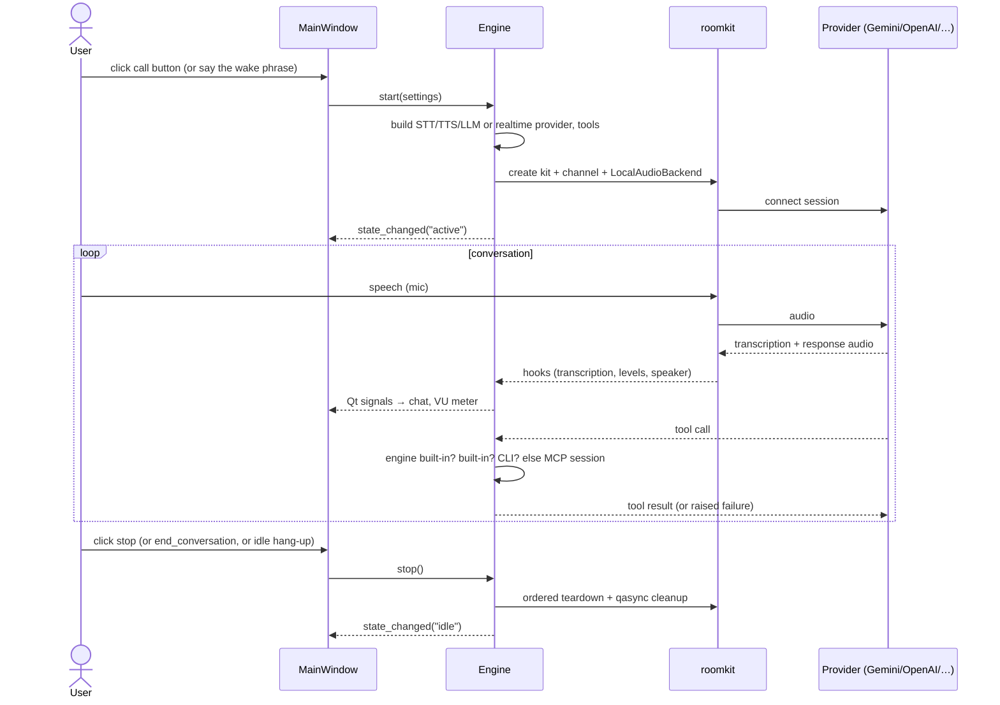
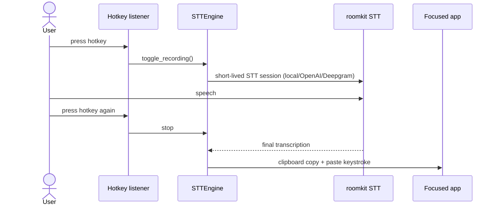

# Features

> _Generated: 2026-06-11 — updated 2026-10-11 for roomkit 0.97.0 — re-run /project-review to update_

Implementation details for each feature are in [technical.md](technical.md);
system context in [architecture.md](architecture.md).

## Core features

### Voice conversation — two modes

| | Realtime (speech-to-speech) | Voice Channel (STT → LLM → TTS) |
|---|---|---|
| Providers | Gemini Live, OpenAI Realtime, OpenAI GPT-Live, Deepgram Voice Agent, ElevenLabs ConvAI, xAI Grok | LLM: Anthropic, OpenAI, Gemini, local (vLLM/Ollama), llama.cpp |
| STT | provider-native | sherpa-onnx (local), Gradium, Deepgram, Azure MAI-Transcribe |
| TTS | provider-native | Piper and Pocket TTS (local), Qwen3-TTS & NeuTTS (voice clone), Gradium, ElevenLabs, Azure MAI-Voice |
| Latency | lowest | depends on the three stages |
| Offline capable | no | yes (local STT + local LLM + Piper or Pocket TTS) |
| Usage shown | tokens | tokens + cost estimate (catalog pricing) |
| Code | `engine_realtime.py`, `realtime_providers.py` | `engine_vc.py`, `engine_vc_helpers.py` |

Both modes share: echo cancellation (WebRTC/Speex), barge-in interruption, optional WAV
recording, MCP + CLI + built-in tools, skills, attitudes, conversation memory, and the
wake word. Voice Channel only: noise suppression (RNNoise/GTCRN), VAD (TEN/Silero),
speaker diarization, the Smart Turn detector, barge-in modes and TTS filtering. A
realtime session started with diarization enabled runs without it and says so in the chat.

A missing backend never fails silently: the provider is marked in Settings, and a session
started with it names the install command in the chat (`features.py`).

### Realtime providers

- **Gemini Live** — options follow what the selected model takes (roomkit's
  `live_model_profile`). On the 3.8 family "AI can speak unprompted" and "Emotional
  responses" are disabled with a tooltip saying why; `gemini-3.8-live-extended-thinking`
  gets a Thinking level; the family gets transcription options (language may change
  mid-conversation, language hints, a custom vocabulary).
- **OpenAI Realtime** — reasoning effort (gpt-realtime-2+), voice speed (0.25–1.5).
- **OpenAI GPT-Live** — full-duplex: it listens while it speaks, can backchannel, and
  hands reasoning and tool calls to a backend model OpenAI hosts ("Tools Model" and its
  effort, gpt-5.6-terra at low by default). Shares the OpenAI key field.
- **Deepgram Voice Agent** — listen/think/speak composition: STT model, language,
  think provider and model, the TTS vendor Deepgram hosts (Aura, ElevenLabs, OpenAI) with
  its voice and speed, and an opt-in half-duplex mode that mutes the mic while the agent
  speaks.
- **ElevenLabs Conversational AI** — agent ID; model, voice and turn detection live on
  the dashboard agent.
- **xAI Grok** — server-VAD tuning (threshold, silence, prefix padding).

Model and voice lists come from roomkit's offline catalogs; a saved id outside the list is
kept, never replaced. Agent Skills reach realtime sessions as well as Voice Channel ones.

### Voice Channel details

- **Model lists** from roomkit's catalogs (Claude, OpenAI, Gemini). Claude defaults to
  Claude Sonnet 5.5 and Gemini to Gemini 3.8 Flash; a stored retired default moves to the
  new one once, and the chat says so. A deprecated model the user picked is kept, with a
  notice at each session.
- **llama.cpp** — a Hugging Face `repo:quant` or a `.gguf` file; roomkit downloads a
  pinned `llama-server` build (SHA-256 checked) and the model, and the server outlives the
  session (one per model and context size).
- **Local model thinking** — "Model thinking (slower answers)", off by default, for vLLM
  and Ollama: a reasoning model otherwise thinks for seconds before a spoken reply. A model
  that always reasons cannot be switched off; the hint says so.
- **Pocket TTS** — Kyutai's local voice, CPU-friendly, in English, French, German,
  Spanish, Italian, Portuguese and Dutch (larger variants for all but English). By default
  it speaks the speech-recognition language (English when Pocket has no model for it); a
  pre-made voice or a WAV to clone (cloning needs the gated `kyutai/pocket-tts` weights).
- **Azure MAI-Transcribe / MAI-Voice** — Microsoft Foundry speech, one resource and one
  key for both. MAI-Transcribe finds no turns itself, so the session always gets a VAD
  (the chosen model, else an energy VAD) with an 800 ms end-of-turn silence by default.
- **ElevenLabs streamed input** — "Stream text to ElevenLabs (lower latency)", on by
  default: each sentence is synthesized as soon as it is written (v4 / v4 Turbo and the
  v2 / v2.5 models). v4 is the default model; v3 has no streaming socket and keeps
  whole-reply synthesis.
- **Barge-in** — Off (the assistant finishes), Any speech interrupts, or Words only:
  roomkit's semantic strategy with its `PhraseBackchannelDetector`, so "ok", "mm-hmm",
  "d'accord" or "merci" let the assistant go on while other words stop it. With a
  streaming STT, sound without words never cuts in. A non-streaming (Whisper-type) local
  STT has no words before the speech ends, so there any speech that lasts stops the
  assistant; the Settings hint says so.
- **TTS filtering** — the voice skips emoji, a JSON object the model wrote instead of
  calling a tool, notes to itself ("(Note: …)"), separators and bracketed stage
  directions; the chat shows the same filtered text. On an ElevenLabs model that performs
  audio tags (v3, v4, v4 Turbo), brackets pass through: "[laughs]" is a cue there.
- **Smart Turn** (`smart-turn` extra) — a turn detector that judges from the audio whether
  the user has finished; "Unfinished Wait (ms)" sets how long an unfinished turn waits for
  more speech. Without the extra the setting reads "not installed", and a session runs
  without it and says so.
- **Turn failures in the chat** — a turn the LLM could not answer (bad key, quota), a TTS
  or STT failure, and a local model without tool support each show a line in the chat. A
  transient provider refusal is retried twice before that.

### Voice Channel agent (Settings → AI → Voice Channel → Agent)

Three add-ons, all off by default. One that cannot run is left out of the session and the
chat says why; none fails the start.

- **Deciding when to speak** — roomkit's `ClassifierSpeakPolicy`: on each turn one
  classifier call judges whether the speaker finished, put it off, asked for quiet or
  spoke to the assistant, and the assistant answers, offers one short sentence, or stays
  quiet. A quiet turn shows "Stayed quiet — <why>" in the chat. "Just listen" keeps it
  listening until spoken to by its name (the tab's Name field, "Assistant" by default).
  The judgments come from OpenAI Decisions (the OpenAI key), TypeSafe Jev (`typesafe`
  extra and key) or the conversation model (one that answers under a JSON schema). Every
  reply waits for the decision; a classifier that fails or misses roomkit's 2 s bound lets
  the assistant answer, said once in the chat.
- **Thinking while listening** — needs a speaking decision. On the turns the assistant
  stays quiet, the conversation model rewrites its thought (what is said, what it could
  add); with something worth saying it may offer it. Thoughts go to the log only.
- **Background work** — the assistant gets roomkit's `work_in_background` tool: a long
  request runs as a task, in a room of its own, with the same model and tools, while the
  conversation goes on; the result comes back as a turn it speaks. The chat shows when a
  task starts and how it ended, and the idle hang-up waits for running tasks. Needs a model
  given tools (not a local model set without tool use).

The session's cost counts the background task's turns (they are AI responses), not the
classifier's or the thinker's calls.

### Wake word

Settings → Wake Word. Detection runs locally and continuously; nothing leaves the
machine until the phrase is heard, which opens a session. It compares sound to sound — no
transcription — so the phrase works in any language.

- **Enrolment** — a guided wizard records the phrase said normally, more quietly and
  from further away, then words that sound close and must not wake it; the threshold is
  measured between the two, and the wizard says when they overlap and suggests a more
  distinctive phrase. The whisper-tiny encoder it needs (~12 MB) downloads from the page.
- **Sensitivity** — Cautious, Balanced or Responsive, scaling the measured threshold.
- **Replay** — the request said right after the phrase reaches the provider: sessions
  subscribe to the shared microphone and replay from the wake mark (both modes, when the
  microphone's rate fits the session).
- **Auto-hangup** — "Hang up when the conversation goes quiet" after a set number of
  seconds (15 by default), never while a tool call is in flight or the assistant speaks;
  the wake word then listens again. Set on this page, it applies to every session, and
  the chat says why the session closed.
- The listener stands down during a session, during dictation and while Settings is open.
  With the wake word off, the shared microphone is released.

(`wakeword/`, `widgets/wakeword_wizard.py`, `idle_hangup.py`, `wakeword` extra)

### Conversation memory

Settings → General → "Remember conversations across sessions", on by default. Sessions
share one persistent history (`conversations.db`, readable by its owner only). The Voice
Channel's AI reads it as context; a realtime provider gets a recap of recent exchanges
(answers the user never heard are left out, cut answers are marked interrupted); the
`recall_conversations` tool lets the assistant search all of it. (`memory.py`)

### System-wide dictation

Press a global hotkey anywhere in the OS, speak, release — the transcription is pasted
into the focused application (macOS, Linux X11/Wayland, Windows). STT can be local
(sherpa-onnx models), OpenAI, or Deepgram. A tray icon shows recording state; a press
during a start or a stop is replayed once it settles. A single-modifier hotkey fires only
on a tap, not when the modifier is part of a chord. (`stt_engine.py`, `hotkey.py`,
`paste.py`, `paste_windows.py`)

### Speaker diarization & primary-speaker mode (Voice Channel only)

Enroll speakers from a 10 s recording (split into overlapping windows for robust
embeddings) on the microphone sessions use. During a session each utterance is attributed
to the voice heard longest over it: the chat labels the enrolled name or "Unknown", and
the model reads the speakers' names once several people talk. *Primary speaker mode*
makes the assistant answer only utterances attributed to the enrolled primary speaker.
(`enrollment.py`, `speaker_manager.py`, `hooks.py`, settings → Speakers)

### Tools: MCP + CLI + built-ins + MCP Apps

- **Built-in tools** (always available): date/time, RoomKit info, attitudes (list, set),
  clipboard paste, end-conversation (only on an explicit goodbye), and
  `recall_conversations` when memory is on. (`builtin_tools.py`, `engine_tools.py`)
- **CLI tools**: declare a local binary once (settings → CLI Tools) and the model can run
  it, its `--help` seeded into the tool description. The page warns that a declared CLI
  runs with the user's permissions and any arguments the assistant chooses, without
  asking. (`cli_tools.py`, `cli_help.py`)
- **MCP servers**: stdio / SSE / streamable-HTTP transports, OAuth2 for HTTP servers,
  configured in settings → MCP. An MCP tool named like a built-in or CLI tool, or with a
  name providers refuse, is left out and named in the chat. (`mcp_manager.py`)
- Dispatch order: engine built-ins, built-ins, CLI tools, then the owning MCP session. A
  failed call is reported to the model as a failure on every provider.
- **MCP Apps**: tools that declare a `ui://` resource render their HTML UI inline in
  the chat (QWebEngineView + JSON-RPC bridge) and can call tools back through the app;
  they cannot reach local or LAN services. (`mcp_app_bridge.py`, `widgets/mcp_app_widget.py`)

### Skills & attitudes

- **Skills**: instruction packages discovered from git repos or local folders;
  settings can search skills.sh through its public search endpoint. GitHub-backed
  results install as explicit Git sources; well-known results install over https into
  local skill folders after validating the public discovery index, then skills are enabled
  per-skill and registered into roomkit's `SkillRegistry`, in both modes.
  (`skill_manager.py`, `skill_git.py`, `skill_well_known.py`, `skills_sh_client.py`)
- **Attitudes**: persona presets (plus user-defined ones) appended to the system prompt;
  switchable mid-session by the user *or by the model itself* via the `set_attitude`
  tool. (`engine_tools.py`)

### Local model management

Settings → AI Models downloads and manages local models: STT (Whisper, Parakeet, Zipformer,
Kroko-FR), TTS (3 Piper French voices, espeak-ng data), VAD (TEN, Silero), speaker
embeddings (TitaNet, WeSpeaker, CAM++), GTCRN denoiser, Smart Turn v3.2. Downloads resolve
GitHub LFS pointers, give up on a stalled connection, and run once per model even if
Settings is reopened mid-download; GPU inference (CUDA/CoreML) is selectable.
(`model_catalog.py`, `model_download.py`, `models_page.py`)

### Recording & audio debug

Settings → Audio Debug: pipeline debug taps and session recording. Recordings are plain,
unencrypted WAV files in a folder the user picks; the page lists, plays (with the
`mcp-apps` extra, which carries QtMultimedia), reveals and deletes them.

### UI

Fixed-size (420×700) chat window: the user's turns in a subtle bubble, the assistant's
text typeset in the column and rolling out with its voice, cut short with an
"— interrupted" mark on barge-in; markdown; animated VU meter; collapsible session-info
bar with token usage; a full-window loading curtain with a Cancel button while a session
connects; dark/light themes; synthesized start/stop sounds; a watchdog that nudges a model
that left the user's speech unanswered. The Settings dialog (13 tabs) has no Save button:
it saves whenever it closes.

## User roles & permissions

Single-user desktop app — no roles, no auth. The OS user owns all data
(settings, conversation history, speaker profiles, wake-word fingerprint, models, tokens).

## Workflows

### Voice session

### Dictation

## Integration points

| Integration | Direction | Notes |
|---|---|---|
| Gemini Live / OpenAI Realtime / GPT-Live / Deepgram Agent / ElevenLabs / Grok | bidirectional WS | speech-to-speech |
| Anthropic / OpenAI / Gemini / vLLM / Ollama APIs | outbound | voice-channel LLM turn |
| llama-server (local) | local HTTP | roomkit downloads the server build and the GGUF model |
| ElevenLabs / Gradium / Deepgram / Azure MAI | outbound | cloud TTS / STT |
| MCP servers | bidirectional | user-configured, OAuth2 for HTTP |
| skills.sh | outbound HTTPS / browser | skill search; GitHub sources install as Git, well-known sources as local folders |
| edge-ai-models GitHub repo, Hugging Face | outbound | model downloads (LFS; Smart Turn and the wake-word encoder pinned by SHA-256) |

## Current limitations

- One session at a time.
- No text input — voice only (paste_text tool exists for the *model* to paste).
- Realtime mode requires a cloud provider; no local speech-to-speech.
- Realtime sessions run without speaker diarization (primary-speaker gating drops the
  audio before the pipeline that would diarize it).
- The Voice Channel agent's add-ons (speaking decision, thinking, background work) are
  Voice Channel only: a realtime model takes its own turns. A session ended while a
  background task runs cancels it.
- The pre-built binaries carry Smart Turn but neither Pocket TTS, Qwen3-TTS nor NeuTTS
  (outside the `all` extra); install from source for those.
- Azure MAI-Transcribe is not offered for dictation.
- MCP Apps require QtWebEngine (graceful fallback to a plain tool pill without it).
- Window size fixed; no chat search/export.
- French-centric Piper catalog (all three Piper voices are French); Pocket TTS covers six
  more languages.

## Potential enhancements

(Not roadmap commitments — gaps that follow naturally from the current design.)

- Conversation transcript export.
- Diarization in realtime mode, once roomkit reports pipeline speaker changes there.
- A per-call confirmation for CLI and MCP tools.
- Broader integration/UI test coverage (see [technical.md — Testing](technical.md#testing-strategy)).
- Broader Piper catalog (English Piper voices are upstream already).
